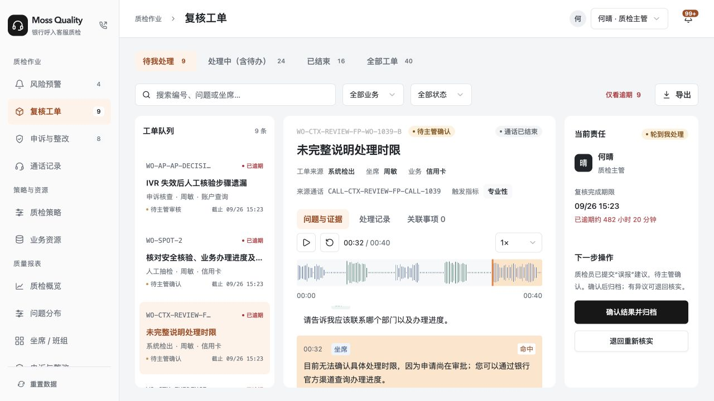

# 6001 Vercel 发布与 PRD 同步

日期：2026-10-16。应用源码节点：76446d2；正式部署提交：094638cec160331c63fc2bb537590fbf41b791c3；工作分支：codex/unified-experience-6001。发布后文档回执继续在同一分支保存，不改变该部署的应用内容。

## 本次范围

- 发布自 2026-10-08 上次线上节点以来的累计 6001 修改。
- 一张复核工单处理一个问题；旧多问题工单定向拆分并保留责任、期限、意见、证据、补件和申诉关联，刷新不重复拆分。
- 问题说明、完整录音转写、预警/发现依据按阅读顺序直接呈现；人工意见和提交信息归入处理记录，主管确认后的去向明确。
- 双角色波形与原话联动、播放/暂停与定位、缺失音频空态；新增 19 种合成对话录音及 38 个编号与转写绑定，不替换未知或编辑后的通话。
- 超时仍按原入口办理、保留原期限并追加超时提交事件；当前阶段期限统一用于列表、筛选、责任区、CSV 和提醒。

## 已完成验证

- pnpm test:workflow：276/276 通过。
- pnpm verify:mvp：通过；其中 67 项为已有子集，不重复累计。
- pnpm lint、pnpm typecheck：通过。
- Vercel 上传清单排除了 .env、node_modules、.next 及本地工具产物。
- Vercel `next build --webpack` 生产构建通过，部署 READY，正式域名已完成切换。
- 线上浏览器：命中原话定位 00:16 / 00:32 且保持暂停；播放推进并跟随当前原话，暂停保留位置；意见显示在处理记录，两类主管确认分别提示分发或归档。未提交业务结果，本轮未捕获控制台错误或警告。
- 本地旧工单 WO-1039 / WO-1039-S2 分别显示，命中定位可用；完整拆分与关联回归由上述自动化覆盖。

## 发布关联

正式入口：https://bank-voice-qc-6001.vercel.app/
飞书 PRD：https://acnc6zeentra.feishu.cn/docx/HfCadGmEroohoOx1qikcA2yAnfh

- 部署 ID：`dpl_F9rNhpjH2sPMuV4FTVkLyvXKGps5`。
- 固定快照：https://bank-voice-qc-6001-7z81vpgcd-hpls-projects.vercel.app 。
- 已使用 Vercel API 核验正式域名返回该部署，`readyState=READY`、`target=production`、`gitCommitSha=094638cec160331c63fc2bb537590fbf41b791c3`。
- 生产部署采用已有账号 h-pl 的 GitHub 可识别提交身份，未修改项目访问保护或全局 Git 设置。

## PRD 回执

现有飞书文档更新为 **6001-R9 / 2026-10-16**，云端修订号由 611 更新至 **644**。按原章节更新 19 处需求与验收正文，12 处发布入口/资产/当前记录，新增 1 条 R9 历史记录，并修正 1 处本地端口。每次写入后回读；最终完整回读确认 8 张图片和 3 张画板与更新前一致。历史发布、标签及截图继续注明日期。

[当前 PRD 本地同步快照](PRD-6001-云端同步快照-20261016.md) 与云端修订号 644 对应；旧本地文档标明历史基础正文，避免误作当前版本。

本轮不新增 tag，v0.2.5-mvp-p0 继续指向 2026-10-08 的历史节点。真实鉴权、CTI/ASR/检测服务与银行环境联调不在本次发布范围；本次未重做所有角色与窄屏端到端验收。
