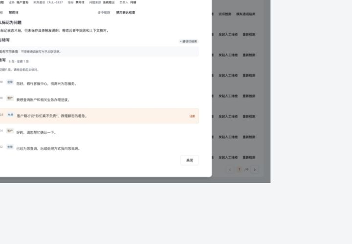
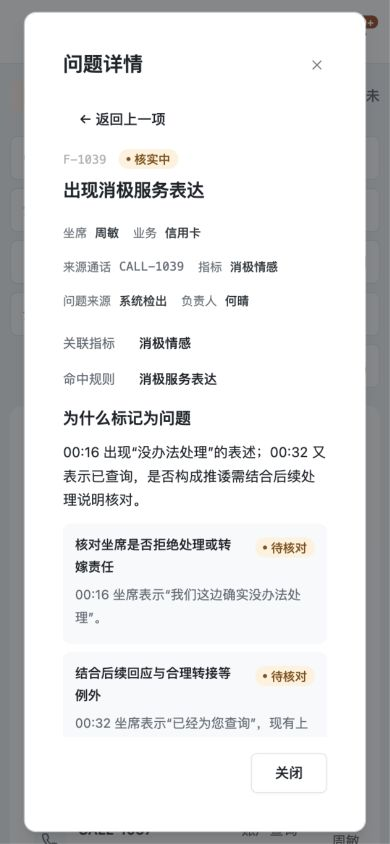

# 6001 版本与指标序号展示清理

2026-09-29，按用户要求移除产品界面的 V/v 版本标记及“· 6.3.x”等指标章节序号。

- 问题详情只保留指标名称和查看按钮，覆盖预警、工单和通话关联详情；同类 6.2.x 序号一起隐藏。
- 补全旧记录展示处理：资源引用变更、资源自动生效、大小写和多段版本号；通知正文、提示及无障碍名称一致。
- 操作成功与错误提示改用“配置”“依据”“内容”等业务文案。
- 报表 CSV 删除“口径版本”列及其固定值。
- 保留内部指标键、历史快照、存储记录及并发检查；通话和工单编号、日期、数量、步骤、办理轮次不变。历史研发文档和依赖版本不属于产品展示。

## 验证

- 类型检查、Lint、独立目录生产构建通过。
- 相关回归 23 项通过；既有 verify:mvp 67 项通过。
- 全部 251 条样例处理记录的展示文本无版本标记残留，导出表头与数据列已核对。
- 浏览器扫描 10 个入口：复核工单、风险预警、申诉与整改、通话记录、质检策略、业务资源，以及 4 个报表模块；可见文案和无障碍树无版本/指标章节序号残留。
- 实际打开问题详情、命中规则与业务依据、字段说明、预警策略；通知列表 128 条检查无残留。
- 桌面与 390px 窄屏详情核验通过，指标按钮保留。

本地 http://localhost:6001 已使用 .next-label-cleanup-20260929 构建更新。未推送、未部署线上；保留原有未提交改动。

