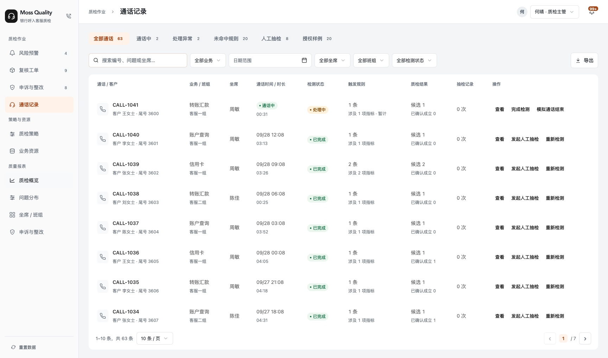

# 通话记录默认查看恢复（2026-09-28）

用户参考版本：https://bank-voice-qc-6001-icfgizclm-hpls-projects.vercel.app/?view=calls

已实际访问参考版本：编号使用突出主标题，整行非操作区域打开通话详情。当前实现改回同样的默认查看动作，沿用现有居中弹窗及只读内容，不恢复历史抽屉或改写 URL 的行为。

通话首列与业务资源对齐为 14px / 600 / 20px 系统字体主标题、12px 客户副信息、32×36px 图标区域；保留白表头、无常驻行线和行悬停反馈。通话编号点击打开详情，复制继续在详情中提供。修改仅涉及 workspace.tsx、catalog-report-design.css 及设计/交互说明，已有其他未提交改动保留。

## 验证

- 1728×1020 桌面：编号、图标、客户副信息、业务单元格均打开通话详情；右侧查看可用，发起人工抽检仍打开独立业务表单。
- Enter/Space 打开，Escape 关闭；关闭后焦点返回入口，URL、搜索条件、分页、列表滚动位置保持。
- 390×844 窄屏：主页面无整体横向溢出，详情弹窗位于视口内，关闭入口可达。
- 业务资源原查看行为继续可用；两页主标题的实际计算字体及颜色一致。
- 生产构建（含 TypeScript）、lint、git diff --check 通过；call-triggers、context-actions、context-entry 共 17 项测试通过。

本地 6001 使用 .next/call-ui-20260928 独立构建运行。未提交、推送或部署线上。

