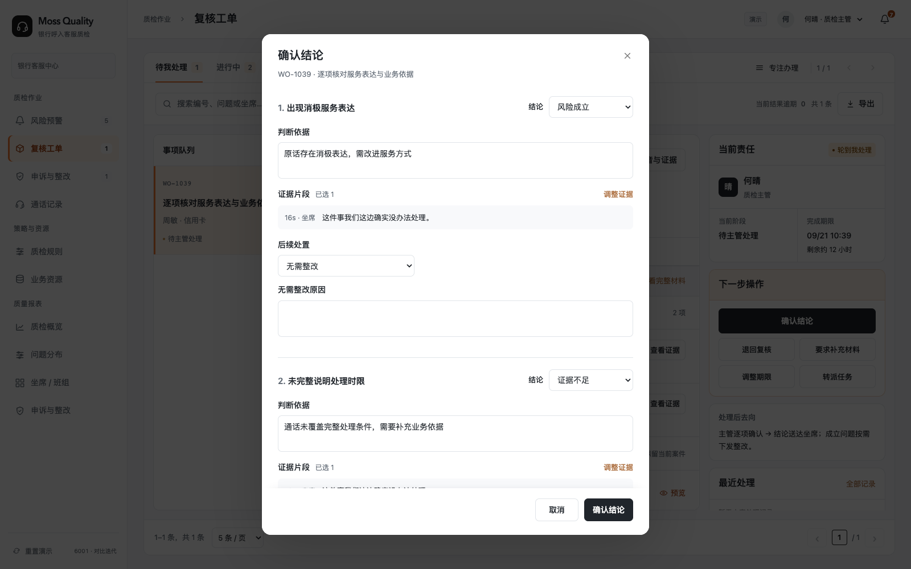
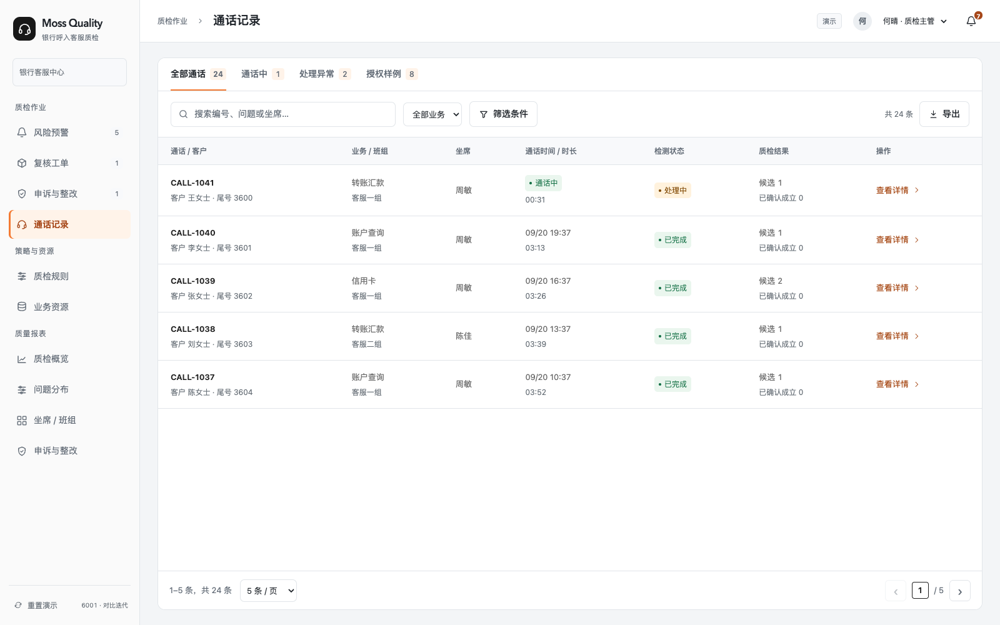
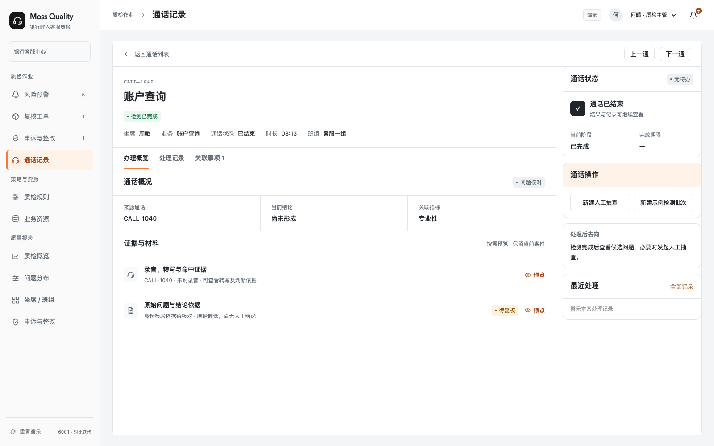
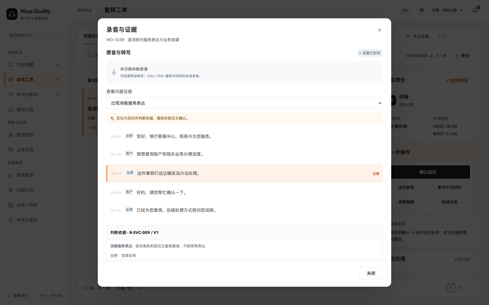
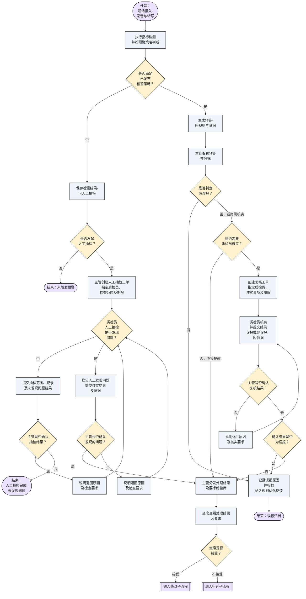
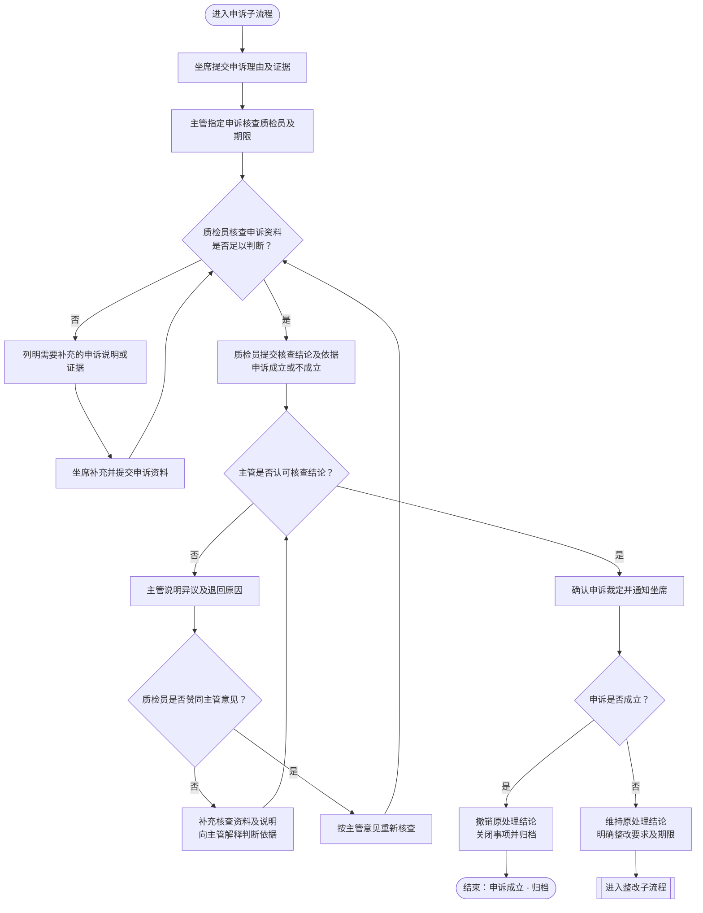
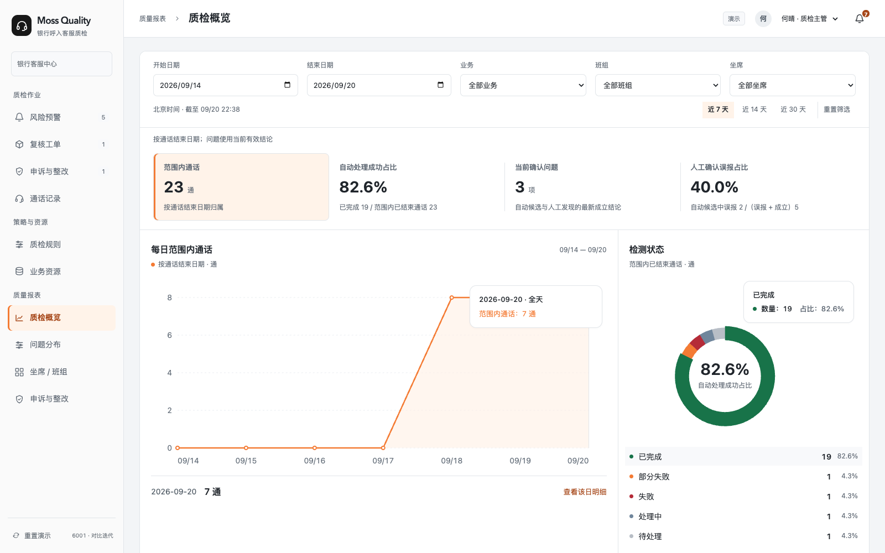
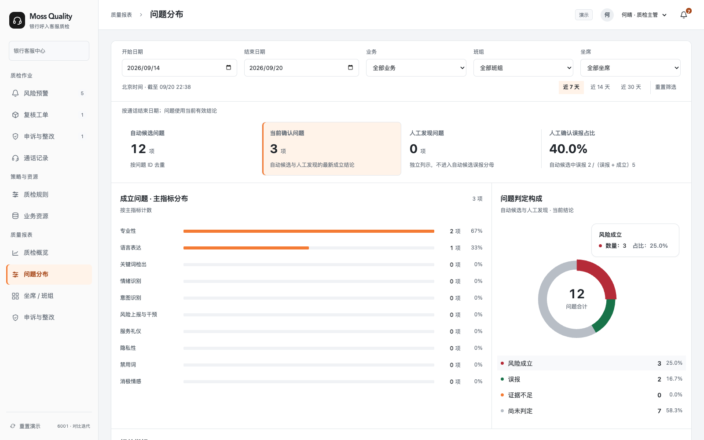
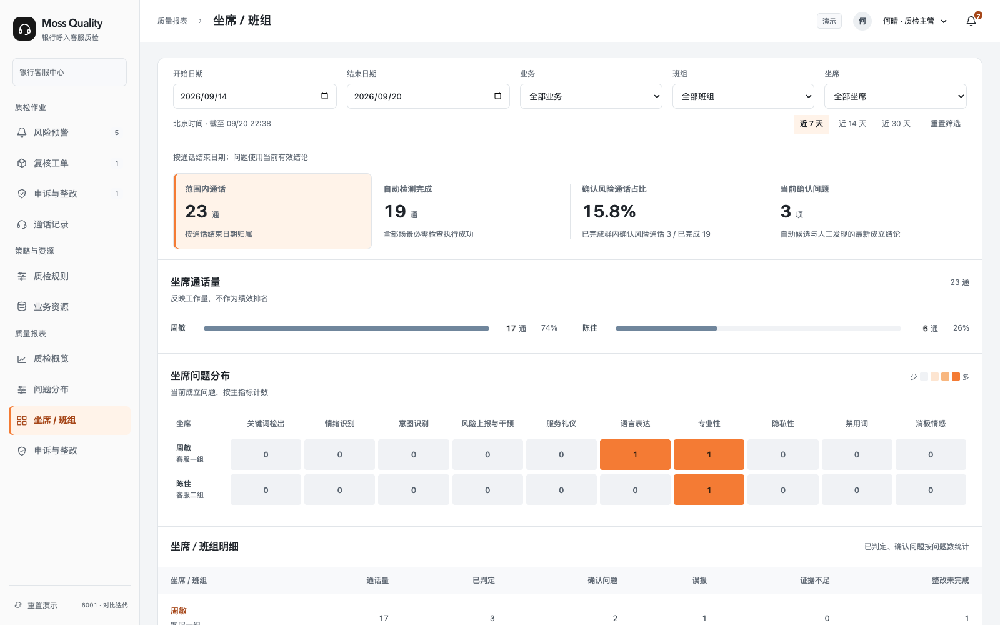
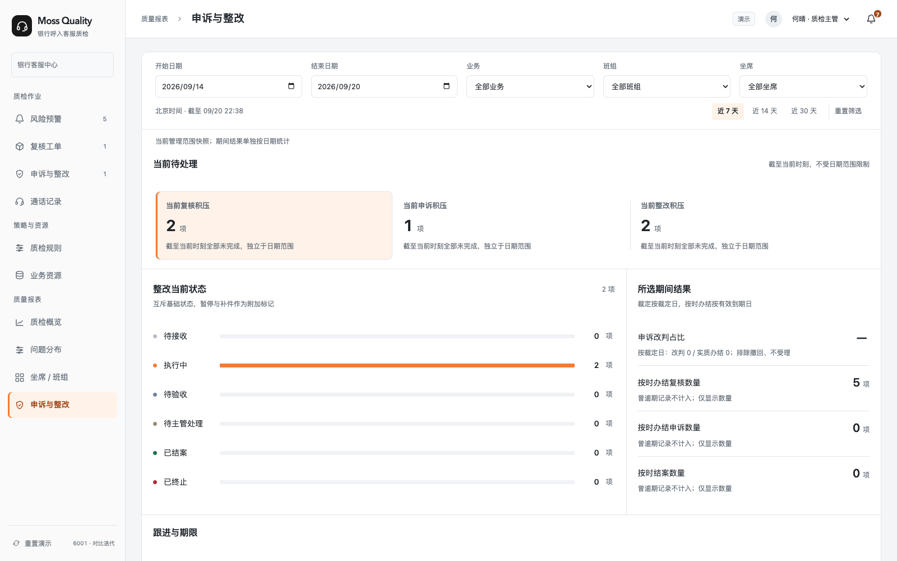

# Moss Quality｜银行语音质检 · 6001 产品需求与研发交付

> 飞书 6001-R9 的本地同步快照，2026-10-16 回读修订号 644。当前权威文档：[飞书 PRD](https://acnc6zeentra.feishu.cn/docx/HfCadGmEroohoOx1qikcA2yAnfh)。图片沿用已有历史资源；画板保留云端直达链接，带 Mermaid 源码的画板保留源码。

需求与页面核对：2026-10-16｜PRD 6001-R9。本次同步一张工单一个问题、旧多问题工单迁移、证据与处理记录分区、双角色合成录音及波形/转写联动，并纳入超时办理和当前任务期限修正。代码已推送至 codex/unified-experience-6001；正式部署提交 094638c，包含应用源码节点 76446d2。Vercel production 构建通过、状态 READY，正式域名已切换并完成线上播放/暂停、命中定位、意见记录及确认去向抽查。276 项自动化测试、MVP 检查、lint 和 TypeScript 通过。v0.2.5-mvp-p0 为 2026-10-08 历史标签。正文以当前规则为准，11 个既有嵌入资源保留；真实鉴权、CTI、ASR、检测、服务存储和通知投递仍待联调。

**当前资产入口**

[线上原型｜Moss Quality · 已部署演示入口](https://bank-voice-qc-6001.vercel.app/)

[GitHub｜银行语音质检 · 私有代码仓库](https://github.com/h-pl/bank-voice-qc-mvp-p0)

[GitHub｜历史截图代码快照 · 8e5eced · 非当前版本](https://github.com/h-pl/bank-voice-qc-mvp-p0/commit/8e5eced72343aa0e5e7dc239d35201d67759602d)

[GitHub｜历史源码标签 · v0.2.5-mvp-p0 · 2026-10-08](https://github.com/h-pl/bank-voice-qc-mvp-p0/tree/v0.2.5-mvp-p0)

[GitHub｜当前正式部署提交 · 094638c · 2026-10-16](https://github.com/h-pl/bank-voice-qc-mvp-p0/commit/094638cec160331c63fc2bb537590fbf41b791c3)

[Vercel｜当前固定部署快照 · 094638c · READY](https://bank-voice-qc-6001-7z81vpgcd-hpls-projects.vercel.app)

[验证记录｜6001 Vercel 发布与 PRD 同步 · 2026-10-16](https://github.com/h-pl/bank-voice-qc-mvp-p0/blob/codex/unified-experience-6001/docs/reviews/6001-Vercel发布与PRD同步-20261016.md)

[目录参考｜MVP-P0-Compromise PRD · 仅参考组织结构](https://acnc6zeentra.feishu.cn/docx/S9zbdxp89oGfXYxKWkTc22QAnef)

[验收资料｜已发布快照对应记录 · 不代表本次需求验收](https://github.com/h-pl/bank-voice-qc-mvp-p0/blob/8e5eced72343aa0e5e7dc239d35201d67759602d/docs/reviews/6001迭代实施与验收-20260920.md)

设计资产：未提供与本次需求一致的独立 Figma 研发稿。保留的界面截图仅说明通用交互与报表呈现；策略配置及业务流程以本文章节为准。私有代码仓库需访问权限。

**阅读与研发导航**

[1 概要](https://acnc6zeentra.feishu.cn/docx/HfCadGmEroohoOx1qikcA2yAnfh#doxcnffRgv0r3U9VLx8zM30qKpd) · [2 协作分工](https://acnc6zeentra.feishu.cn/docx/HfCadGmEroohoOx1qikcA2yAnfh#doxcnzHtgyxt84QrovovIELHtqf) · [3 背景与交付范围](https://acnc6zeentra.feishu.cn/docx/HfCadGmEroohoOx1qikcA2yAnfh#doxcncaJAc7GSTosc7lISfzkuih) · [4 目标与验收结果](https://acnc6zeentra.feishu.cn/docx/HfCadGmEroohoOx1qikcA2yAnfh#doxcnfHRY3Ip4ey3BaXPwZlVA8c) · [5 使用者与任务](https://acnc6zeentra.feishu.cn/docx/HfCadGmEroohoOx1qikcA2yAnfh#doxcnJDnwsiR8FCriq0fA0luDre) · [6 用户价值](https://acnc6zeentra.feishu.cn/docx/HfCadGmEroohoOx1qikcA2yAnfh#doxcnAi8kJn6SOOuReArjJFGblf) · [7 需求、流程与研发契约](https://acnc6zeentra.feishu.cn/docx/HfCadGmEroohoOx1qikcA2yAnfh#doxcnPvvKMf1I2a0h6T1SpCK8kc) · [8 交付与上线](https://acnc6zeentra.feishu.cn/docx/HfCadGmEroohoOx1qikcA2yAnfh#doxcnvdx5nHhOQbNVfle4OCGNad)

研发直达：[页面地图与线上入口](https://acnc6zeentra.feishu.cn/docx/HfCadGmEroohoOx1qikcA2yAnfh#doxcnhfuLuGJOaAFLuBMXmAaind) · [本轮研发调整定位与功能清单](https://acnc6zeentra.feishu.cn/docx/HfCadGmEroohoOx1qikcA2yAnfh#doxcnjp4N4YUOlB5NDT5ubFmhGf) · [身份与权限](https://acnc6zeentra.feishu.cn/docx/HfCadGmEroohoOx1qikcA2yAnfh#doxcn9bEZbsLwAKUDDsKxjv5bli) · [共用 UI 与交互](https://acnc6zeentra.feishu.cn/docx/HfCadGmEroohoOx1qikcA2yAnfh#doxcn6Jrd35SOWbbmao4lblU2bc) · [接口与异常处理要求](https://acnc6zeentra.feishu.cn/docx/HfCadGmEroohoOx1qikcA2yAnfh#doxcnl5io6HIq8o41yBX5zIfmoe) · [验收场景](https://acnc6zeentra.feishu.cn/docx/HfCadGmEroohoOx1qikcA2yAnfh#doxcnGUnbl7uyCcTcPdQLIAU7yh) · [字段生命周期说明](https://acnc6zeentra.feishu.cn/docx/HfCadGmEroohoOx1qikcA2yAnfh#doxcngWexdsjU6R44gyS1lsbPTb)

研发按第 3 章功能编号进入第 7 章；测试以第 7 章末尾唯一验收表组织用例；集成负责人先核对第 8 章未接入能力。飞书原生目录由以下八章及子标题生成。

**更新日志**

| 版本 / 日期 | 已完成修订 | 影响范围 |
| --- | --- | --- |
| 6001-R5 / 2026-09-23 | 按八章结构清理冲突与冗余，补齐 7.9 分节编号；统一指标特有字段、通用策略和固定资源引用；修正导航、验收及实现差异；7.11.3 按流程事件整理生命周期字段角色矩阵，列明23个字段选项及系统、主管、质检员、坐席的赋值职责；明确误报归档状态、查询入口及申诉撤销的归档分流。 统一预警五页签顺序及误报归档术语，明确归档查询入口、通话汇总和问题独立生命周期。 修正人工抽检独立确认分支，补齐补派核验人及核验不满足后的整改状态流转，并收窄误报归档状态的定义。 | 全文文档修订；本次未修改或部署原型。 |

6001-R6 / 2026-09-24：同步 GitHub 提交 9edfac0，纳入 9 月 22—23 日的工作流、配置直接保存、资源维护、统一界面、样例及模拟接入。随后以 4d424ac 完成 Vercel production 部署，演示域名已更新；后续提交仅补充部署配置和记录。更新资产入口、验证结果和实现差异；旧截图仍标注 8e5eced，生产联调待完成。

6001-R7 / 2026-09-27：按页面与 PRD 差异采纳建议完成本地 6001 修正：统一复核及申诉核查期限、转派保留原期限、标题搜索与人工来源归档跳转；修正申诉结果、整改阶段及自动误报/人工撤销报表口径；CSV 增加上传反馈与撤销；补齐调整申请出口及坐席回应期限。保留新版筛选、分页、抽屉和分模块对象计数。243 项回归、类型检查、lint、MVP 检查及生产构建通过；本次未部署 Vercel，生产提醒服务仍待联调。正文相关规则已逐段同步，三条主流程图及其余嵌入资源保留。

6001-R8 / 2026-10-08：同步 6001 最新完整源码与线上正式版本，发布标签 v0.2.5-mvp-p0，提交 0927edf。正文已按现有章节更新直接证据阅读、规则详情精简、录音/转写/命中区间联动、版本与指标序号隐藏、只读弹窗、资源与日历控件；保留既有业务流程与 11 个嵌入资源。249 项全量回归、MVP 检查、lint、类型检查及生产构建通过；Vercel production 已完成。真实服务联调范围不变。

6001-R9 / 2026-10-16：发布提交 094638c（应用源码 76446d2），生产部署 dpl_F9rNhpjH2sPMuV4FTVkLyvXKGps5，正式域名已更新。正文逐段同步单问题工单、旧多问题迁移、证据和处理记录、合成对话录音、音频交互、超时办理及任务期限；保留原有 11 个图片和画板。276 项自动化、MVP、lint、类型检查和 Vercel 构建通过，线上录音与记录抽查完成。本轮未新增 tag，v0.2.5-mvp-p0 为历史节点；真实服务联调范围不变。

## 概要

Moss Quality 面向银行呼入客服质检，将通话证据、风险候选、人工复核、主管结论、坐席申诉与整改串成可追溯闭环。核心对象是可核对的问题及其版本化结论，系统检测结果只作为候选，不直接替代人工裁定。

产品主线为检测与证据、预警分流、人工复核、主管确认、坐席申诉与整改。办理入口集中在复核工单等业务模块，待办通过模块计数和顶部通知呈现；策略与资源负责规则、预警条件及业务依据，质量报表负责分析。

**主流程** 命中规则 → 生成预警 → 主管初审 • 误报 → 记录原因 → 关闭归档 • 需要核实 → 质检员核查 → 主管确认 → 误报归档 / 非误报分发 • 无需核实 → 直接分发处理结果及要求 坐席查看结果 → 接受：进入整改 / 不接受：进入申诉 未命中规则 → 可人工抽检 → 未发现问题：主管确认后办结 / 发现问题：主管确认后分发

**整改流程** 坐席整改并提交资料 → 质检员核验 • 不满足要求 → 列明补充要求 → 退回坐席整改 • 满足要求 → 主管审核 → 通过：整改完成 / 不通过：退回质检员 质检员核对主管意见： • 不赞同 → 补充核验依据 → 交主管审核 • 赞同 → 补充整改要求 → 退回坐席 → 重新提交核验

**申诉流程** 坐席提交申诉 → 质检员核查并提交意见 → 主管确认 • 申诉成立 → 撤销原结论 → 归档 • 申诉不成立 → 进入整改 主管不认可核查意见 → 退回质检员 → 核对主管意见： • 不赞同 → 补充核查依据 → 交主管确认 • 赞同 → 按主管意见重新核查（必要时由坐席补充材料）→ 再交主管确认

## 协作分工

| 参与方 | 责任与交付物 | 确认边界 |
| --- | --- | --- |
| 业务 / 合规代表（负责人待落实） | 确认检查依据、证据范围、申诉与整改规则、留存与访问要求。 | 正式业务口径、规则白名单、客户 SLA。 |
| 产品 / 设计（负责人待落实） | 维护 F01–F12、页面结构、状态文案和异常交互。 | 需求范围、交互验收与变更记录。 |
| 前端研发（负责人待落实） | 按页面契约实现状态、表单、焦点、筛选、图表和导出。 | 界面与返回路径；不把本地演示权限当服务端授权。 |
| 后端 / 集成（负责人待落实） | 建设鉴权、案件事务、业务处理记录、音频与检测接口；规则、资源和策略的版本快照及版本管理随 P2 建设。 | 幂等、并发、持久化、组织隔离与恢复能力。 |
| 测试 / 数据（负责人待落实） | 按唯一验收表覆盖角色与业务生命周期；统计和配置历史版本分别随 P2 验收。 | 自动化证据、联调结果和统计对账。 |

## 背景与交付范围

银行质检需要在同一案件中核对原音、规则依据、人工结论和后续处理，并明确每一步责任。客户需要维护业务资源与可配置规则；共用预警条件集中维护，避免同一字段在多个页面重复定义。

### 页面地图与线上入口

应用使用根路径 / 与 query 参数，以下均为真实入口。id 定位对象，module 定位报表子模块；弹窗属于页面状态，没有另造独立路由。质量报表中的“申诉与整改”用于分析，质检作业中的同名页面用于办理。

| 页面 / 功能 | 实际路径与线上入口 | 角色 / 进入方式 | 当前状态 / 需求 |
| --- | --- | --- | --- |
| 复核工单 | [?view=workorders](https://bank-voice-qc-6001.vercel.app/?view=workorders) | 主管 / 质检员；坐席只读可见记录 | 已有演示；目标见 [7.5](https://acnc6zeentra.feishu.cn/docx/HfCadGmEroohoOx1qikcA2yAnfh#doxcn9J6CwQut0RANtZ18nQH6Nd) |
| 风险预警 | [?view=alerts](https://bank-voice-qc-6001.vercel.app/?view=alerts) | 主管管理范围 | 已有演示；目标见 [7.4](https://acnc6zeentra.feishu.cn/docx/HfCadGmEroohoOx1qikcA2yAnfh#doxcnftHiiCL4EqTCPPPrkt5h4n) |
| 申诉与整改 · 办理 | [?view=improvement](https://bank-voice-qc-6001.vercel.app/?view=improvement) | 主管、相关质检员、本人坐席 | 已有演示；目标见 [7.6](https://acnc6zeentra.feishu.cn/docx/HfCadGmEroohoOx1qikcA2yAnfh#doxcnsOOE3YJXXF0Ns9QWIj72kn) · [7.7](https://acnc6zeentra.feishu.cn/docx/HfCadGmEroohoOx1qikcA2yAnfh#doxcnsKkRwUhiYsyhtk8KUIvrrg) |
| 通话记录 | [?view=calls](https://bank-voice-qc-6001.vercel.app/?view=calls) | 按角色授权的通话 | 已有演示；目标见 [7.3](https://acnc6zeentra.feishu.cn/docx/HfCadGmEroohoOx1qikcA2yAnfh#doxcnWlUsgEymrzBs8XnTxzsHKd) |
| 通话详情示例 | [?view=calls&id=CALL-1040](https://bank-voice-qc-6001.vercel.app/?view=calls&id=CALL-1040) | 由列表或来源事项进入 | 已有演示；目标见 [7.3](https://acnc6zeentra.feishu.cn/docx/HfCadGmEroohoOx1qikcA2yAnfh#doxcnWlUsgEymrzBs8XnTxzsHKd) |
| 质检策略 | [?view=rules](https://bank-voice-qc-6001.vercel.app/?view=rules) | 主管维护策略，质检员只读；页内切换指标与预警策略 | 已有演示；目标见 [7.9](https://acnc6zeentra.feishu.cn/docx/HfCadGmEroohoOx1qikcA2yAnfh#doxcnAxBimhzDjO6c3OkEWfBkng) |
| 业务资源 | [?view=resources](https://bank-voice-qc-6001.vercel.app/?view=resources) | 主管维护，质检员查看 / 提意见 | 已有演示；目标见 [7.9](https://acnc6zeentra.feishu.cn/docx/HfCadGmEroohoOx1qikcA2yAnfh#doxcnAxBimhzDjO6c3OkEWfBkng) |
| 资源详情示例 | [?view=resources&id=RES-WORD](https://bank-voice-qc-6001.vercel.app/?view=resources&id=RES-WORD) | 列表或关联规则进入 | 已有演示；目标见 [7.9](https://acnc6zeentra.feishu.cn/docx/HfCadGmEroohoOx1qikcA2yAnfh#doxcnAxBimhzDjO6c3OkEWfBkng) |
| 质检概览 | [?view=reports&module=overview](https://bank-voice-qc-6001.vercel.app/?view=reports&module=overview) | 主管 | 已有演示；目标见 [7.10](https://acnc6zeentra.feishu.cn/docx/HfCadGmEroohoOx1qikcA2yAnfh#doxcn3xASP4E3LYZ0plnz1WFsMh) |
| 问题分布 | [?view=reports&module=issues](https://bank-voice-qc-6001.vercel.app/?view=reports&module=issues) | 主管 | 已有演示；目标见 [7.10](https://acnc6zeentra.feishu.cn/docx/HfCadGmEroohoOx1qikcA2yAnfh#doxcn3xASP4E3LYZ0plnz1WFsMh) |
| 坐席 / 班组 | [?view=reports&module=teams](https://bank-voice-qc-6001.vercel.app/?view=reports&module=teams) | 主管 | 已有演示；目标见 [7.10](https://acnc6zeentra.feishu.cn/docx/HfCadGmEroohoOx1qikcA2yAnfh#doxcn3xASP4E3LYZ0plnz1WFsMh) |
| 申诉与整改 · 报表 | [?view=reports&module=improvement](https://bank-voice-qc-6001.vercel.app/?view=reports&module=improvement) | 主管 | 已有演示；目标见 [7.10](https://acnc6zeentra.feishu.cn/docx/HfCadGmEroohoOx1qikcA2yAnfh#doxcn3xASP4E3LYZ0plnz1WFsMh) |

兼容入口 ?view=overview 跳转复核工单。四个报表子模块直接列在侧栏“质量报表”下，正文不再重复页签或大标题。

### 本轮研发调整定位与功能清单

功能范围与优先级：P0 为首期可验收的质检闭环；P1 为实时提醒与规则、资源维护增强；P2 为质量报表及配置版本管理。F11 的四个报表子模块及其筛选、图表 callout、下钻、CSV 导出全部列为 P2。F09、F10 中规则、资源、策略及关联关系的版本号、自动快照、历史记录、版本切换、差异对比、回退和版本发布流程也全部列为 P2，不阻塞 P0 / P1 验收。业务办理中的申诉与整改 F06–F08 仍属于 P0。质量报表与版本管理降为 P2 是用户明确决定；其余优先级与周次为建议方案，版本管理排期待 P2 细化时确定。

本轮研发定位：业务流转按第 7.4–7.7 节三张流程图执行；策略与资源按第 7.9 节实现。现有本地页面与目标需求的差异集中列在第 8.2 节。建议周次面向真实服务建设和联调，不等同于已完成生产交付。

| 编号 | 功能名称 | 当前有效行为 | 优先级 / 建议排期 | 详细规则 | 验收 |
| --- | --- | --- | --- | --- | --- |
| F01 | [通话记录与证据](https://acnc6zeentra.feishu.cn/docx/HfCadGmEroohoOx1qikcA2yAnfh#doxcnWlUsgEymrzBs8XnTxzsHKd) | 通话筛选、详情、音频与转写预览、抽查入口 | P0 · W1–W2 | [7.3](https://acnc6zeentra.feishu.cn/docx/HfCadGmEroohoOx1qikcA2yAnfh#doxcnWlUsgEymrzBs8XnTxzsHKd) | [A02](https://acnc6zeentra.feishu.cn/docx/HfCadGmEroohoOx1qikcA2yAnfh#doxcnQVCl3K3592DI99ywh2f1lc) |
| F02 | [风险筛选与分流](https://acnc6zeentra.feishu.cn/docx/HfCadGmEroohoOx1qikcA2yAnfh#doxcnftHiiCL4EqTCPPPrkt5h4n) | 主管初审为误报归档、转人工核实或直接分发；不单设材料不足初审出口 | P0 · W2 | [7.4](https://acnc6zeentra.feishu.cn/docx/HfCadGmEroohoOx1qikcA2yAnfh#doxcnftHiiCL4EqTCPPPrkt5h4n) | [A03](https://acnc6zeentra.feishu.cn/docx/HfCadGmEroohoOx1qikcA2yAnfh#doxcnEBQjprouutfkHLWOA4kCPb) |
| F03 | [通话中提醒](https://acnc6zeentra.feishu.cn/docx/HfCadGmEroohoOx1qikcA2yAnfh#doxcnftHiiCL4EqTCPPPrkt5h4n) | 提醒反馈与人工确认分离 | P1 · W5–W6 | [7.4](https://acnc6zeentra.feishu.cn/docx/HfCadGmEroohoOx1qikcA2yAnfh#doxcnftHiiCL4EqTCPPPrkt5h4n) | [A03](https://acnc6zeentra.feishu.cn/docx/HfCadGmEroohoOx1qikcA2yAnfh#doxcnEBQjprouutfkHLWOA4kCPb) |
| F04 | [人工复核](https://acnc6zeentra.feishu.cn/docx/HfCadGmEroohoOx1qikcA2yAnfh#doxcn9J6CwQut0RANtZ18nQH6Nd) | 一张复核工单处理一个问题，保存该问题的意见与证据；未发现问题的人工抽检保留明确检查范围。 | P0 · W2–W3 | [7.5](https://acnc6zeentra.feishu.cn/docx/HfCadGmEroohoOx1qikcA2yAnfh#doxcn9J6CwQut0RANtZ18nQH6Nd) | [A04](https://acnc6zeentra.feishu.cn/docx/HfCadGmEroohoOx1qikcA2yAnfh#doxcnfMyY6W4hmPFXKZgTnIzt2f) |
| F05 | [主管确认](https://acnc6zeentra.feishu.cn/docx/HfCadGmEroohoOx1qikcA2yAnfh#doxcn9J6CwQut0RANtZ18nQH6Nd) | 主管确认复核结论，非误报分发给坐席；接受进入整改，不接受进入申诉 | P0 · W2–W3 | [7.5](https://acnc6zeentra.feishu.cn/docx/HfCadGmEroohoOx1qikcA2yAnfh#doxcn9J6CwQut0RANtZ18nQH6Nd) | [A05](https://acnc6zeentra.feishu.cn/docx/HfCadGmEroohoOx1qikcA2yAnfh#doxcn5cfMPRP9uKuZJTU6cdWo4f) |
| F06 | [申诉核查与裁定](https://acnc6zeentra.feishu.cn/docx/HfCadGmEroohoOx1qikcA2yAnfh#doxcnsOOE3YJXXF0Ns9QWIj72kn) | 申诉后指派核查，补证、主管审核与意见往返；成立撤销，不成立转整改 | P0 · W3–W4 | [7.6](https://acnc6zeentra.feishu.cn/docx/HfCadGmEroohoOx1qikcA2yAnfh#doxcnsOOE3YJXXF0Ns9QWIj72kn) | [A06](https://acnc6zeentra.feishu.cn/docx/HfCadGmEroohoOx1qikcA2yAnfh#doxcnclGQecMu7mRSmVc2jfefRc) |
| F07 | [整改执行与验收](https://acnc6zeentra.feishu.cn/docx/HfCadGmEroohoOx1qikcA2yAnfh#doxcnsKkRwUhiYsyhtk8KUIvrrg) | 坐席先整改并提交资料；核验前落实质检员，质检员核验、主管确认结案 | P0 · W3–W4 | [7.7](https://acnc6zeentra.feishu.cn/docx/HfCadGmEroohoOx1qikcA2yAnfh#doxcnsKkRwUhiYsyhtk8KUIvrrg) | [A07](https://acnc6zeentra.feishu.cn/docx/HfCadGmEroohoOx1qikcA2yAnfh#doxcnY27z0QhTDrUIvPA2r1kqzg) |
| F08 | [申诉与整改联动](https://acnc6zeentra.feishu.cn/docx/HfCadGmEroohoOx1qikcA2yAnfh#doxcnsKkRwUhiYsyhtk8KUIvrrg) | 坐席选择分流，申诉裁定后关闭或进入整改；结论及材料按版本留痕 | P0 · W3–W4 | [7.7](https://acnc6zeentra.feishu.cn/docx/HfCadGmEroohoOx1qikcA2yAnfh#doxcnsKkRwUhiYsyhtk8KUIvrrg) | [A08](https://acnc6zeentra.feishu.cn/docx/HfCadGmEroohoOx1qikcA2yAnfh#doxcnvOA49qAjhQ87sjQZvnwTGg) |
| F09 | [指标规则与预警策略](https://acnc6zeentra.feishu.cn/docx/HfCadGmEroohoOx1qikcA2yAnfh#doxcnAxBimhzDjO6c3OkEWfBkng) | 12 类指标目录、四类特征、通用预警条件及校验保存；版本管理子项为 P2 | P1 · W5–W6 | [7.8 检测契约](https://acnc6zeentra.feishu.cn/docx/HfCadGmEroohoOx1qikcA2yAnfh#doxcnkDoBxAmJXGUHyl1nUCJsBb) · [7.9 配置](https://acnc6zeentra.feishu.cn/docx/HfCadGmEroohoOx1qikcA2yAnfh#doxcnAxBimhzDjO6c3OkEWfBkng) | [A09](https://acnc6zeentra.feishu.cn/docx/HfCadGmEroohoOx1qikcA2yAnfh#doxcnFhuSoeTB6H3pKiAQFiremb) |
| F10 | [业务资源与固定引用](https://acnc6zeentra.feishu.cn/docx/HfCadGmEroohoOx1qikcA2yAnfh#doxcnAxBimhzDjO6c3OkEWfBkng) | 业务资源按类型固定引用；校验保存后用于后续新启动的检测；版本管理子项为 P2 | P1 · W5–W6 | [7.9](https://acnc6zeentra.feishu.cn/docx/HfCadGmEroohoOx1qikcA2yAnfh#doxcnAxBimhzDjO6c3OkEWfBkng) | [A10](https://acnc6zeentra.feishu.cn/docx/HfCadGmEroohoOx1qikcA2yAnfh#doxcnCVBfRuhtUxVTCE9CjKSfUc) |
| F11 | [质量报表四子模块](https://acnc6zeentra.feishu.cn/docx/HfCadGmEroohoOx1qikcA2yAnfh#doxcn3xASP4E3LYZ0plnz1WFsMh) | 统一筛选、常显 callout、同口径下钻与 CSV | P2 · W7–W8 | [7.10](https://acnc6zeentra.feishu.cn/docx/HfCadGmEroohoOx1qikcA2yAnfh#doxcn3xASP4E3LYZ0plnz1WFsMh) | [A11](https://acnc6zeentra.feishu.cn/docx/HfCadGmEroohoOx1qikcA2yAnfh#doxcnz8X7u5vfVMlYqKQ9jk582Q) · [A12](https://acnc6zeentra.feishu.cn/docx/HfCadGmEroohoOx1qikcA2yAnfh#doxcnBzAakMqpTRcuRRmv7DT1nf) |
| F12 | [通知与统一交互](https://acnc6zeentra.feishu.cn/docx/HfCadGmEroohoOx1qikcA2yAnfh#doxcn6Jrd35SOWbbmao4lblU2bc) | 责任路由、弹窗、权限、返回与异常保护 | P0 · W1–W4 | [7.2](https://acnc6zeentra.feishu.cn/docx/HfCadGmEroohoOx1qikcA2yAnfh#doxcn6Jrd35SOWbbmao4lblU2bc) · [7.11](https://acnc6zeentra.feishu.cn/docx/HfCadGmEroohoOx1qikcA2yAnfh#doxcn2jOJa7R6QLmC4g2wU5uiNd) | [A01](https://acnc6zeentra.feishu.cn/docx/HfCadGmEroohoOx1qikcA2yAnfh#doxcnEVV3RAWaeHE6DEHiuz8gpg) · [A13](https://acnc6zeentra.feishu.cn/docx/HfCadGmEroohoOx1qikcA2yAnfh#doxcnn6vB3nbMZEPkqWUIaHZQwc) · [A14](https://acnc6zeentra.feishu.cn/docx/HfCadGmEroohoOx1qikcA2yAnfh#doxcnSHTyRYrdkwWpaeEJDaiwJh) |

### 原型与生产的责任边界

| 层次 | 原型表达 / 实现边界 | 生产接入仍需完成 |
| --- | --- | --- |
| 前端交互 | 多角色演示、筛选分页、操作表单、状态流转、版本快照、报表与导出。 | 真实组织身份、端到端服务错误、跨设备一致性。 |
| 状态 / 权限 | 浏览器本地持久化；前端角色与责任校验；rev / requestId 演示冲突和幂等。 | 服务端授权、事务、数据库持久化、并发和审计存储。 |
| 检测 / 录音 | 预设检测与转写；带录音样例可回听，缺失录音有明确空态。 | CTI / 录音接入、ASR、声纹、模型检测、真实资源解析及任务调度。 |
| 发布与可用性 | 2026-10-16 已更新现有线上演示地址 https://bank-voice-qc-6001.vercel.app/。Vercel production 对应提交 094638c，包含应用源码节点 76446d2；主域名已切换。v0.2.5-mvp-p0 仍为 2026-10-08 的历史源码标签。 | 银行部署环境、容灾、留存期限、容量、监控和生产验收。 |

## 目标与验收结果

| 目标 | 衡量口径 | 当前状态 |
| --- | --- | --- |
| 办理责任清楚 | 每个阶段可查当前责任人、允许操作、证据与下一步；具体场景见 7.13。 | 2026-10-16 全量 276 项自动化测试、MVP 检查、lint、TypeScript 和 Vercel 生产构建通过；MVP 的 67 项为已有子集，不重复累计。生产部署 READY，正式域名已核验指向提交 094638c。发布后浏览器抽查：命中原话定位 00:16 / 00:32、保持暂停，播放进度推进并跟随当前原话，暂停保留位置；人工意见在处理记录、两类主管确认分别提示分发或归档；本轮检查未捕获控制台错误或警告。旧工单拆分另有本地浏览器观察及自动化覆盖。既有桌面和窄屏记录保留原日期，本次未重新执行全部角色与真实服务联调。 |
| 配置归属一致 | 四项特有特征随策略选择；通用条件集中维护；业务资源按类型固定引用。 | 以 7.9 两张表为准；实现差异见 8.2。 |
| 业务闭环可追溯 | 结论、补件、整改轮次及检测依据可核对，保留原业务记录；失败不得产生半完成业务结果。检测、策略与资源的配置版本查询、快照及版本级追溯列入 P2，不作为本期通过条件。 | 原型记录可演示；服务端事务、并发和存储待联调。 |
| 统计可解释 | 对象、日期和分母明确；同一条件下页面、明细和导出可对账。 | 统计口径见 7.10；生产样本与质量门槛待确认。 |

具体场景与通过标准统一维护在 [7.13 验收场景](https://acnc6zeentra.feishu.cn/docx/HfCadGmEroohoOx1qikcA2yAnfh#doxcnGUnbl7uyCcTcPdQLIAU7yh)；执行时记录环境、版本、样本、结果与证据。模拟结果不能证明真实检测效果或生产服务通过。

## 使用者与任务

| 使用者 | 任务触发与主线 | 可观察的完成结果 |
| --- | --- | --- |
| 质检主管 | 查看预警并初审；确认复核结果后分发，或直接提醒；仅对直接提醒且坐席直接接受整改的路径新增分配验收人；申诉分支按流程分派核查人；审核并最终结案。 | 误报归档或形成明确分发结果；待指派不阻塞坐席整改，核验前必须落实质检员。 |
| 质检员 | 核实问题、抽检通话、核查申诉或验收整改；核对主管退回意见，不赞同则补依据给主管，赞同则按对应流程重查或退回坐席。 | 意见提交到主管；复测意见绑定本轮标准，不能替主管最终裁定。 |
| 客服坐席 | 查看处理结果及要求；接受则整改、提交资料，不接受则提交申诉；未指派验收人时可先整改。 | 材料进入原案件；只访问本人授权范围，不取得主管处置权限。 |

## 用户价值

主管在一个案件上下文中理解“事实、当前责任、下一步”，用报表定位需要处理的对象；质检员保留证据与检查范围，减少同一结论多处重复录入；坐席能够看到结论依据、申诉入口与具体整改标准。研发可从稳定功能编号定位流程、字段与验收，避免把页面样式当作业务规则。以上是预期价值，尚无实测收益数据。

## 需求、流程与研发契约

### 身份与权限

演示身份由顶部选择器切换；生产身份应来自可信认证。界面隐藏入口仅改善体验，服务端必须对每次读写、导出、统计和附件访问重新验证角色、组织、对象归属与当前责任。

| 操作面 | 主管 | 质检员 | 坐席 |
| --- | --- | --- | --- |
| 风险 / 复核 / 申诉 | 管理范围内分流、确认、裁定与转派 | 本人分派任务及授权证据；提交意见 | 本人结论与可申诉版本；不能裁定 |
| 整改 | 明确处理要求、落实验收人、审核结案；不认可验收结果时退回质检员并说明原因。 | 核验材料；不满足则提出整改 / 补充要求；主管退回后区分补充说明给主管或退回坐席。 | 接受结果后即可整改并提交材料，无需等待验收人指派。 |
| 规则 / 资源 | 预警策略和资源维护、校验保存；按类型固定引用。版本管理列入 P2。 | 规则与资源只读，可提出依据建议 | 仅案件中必要引用，不提供独立管理导航 |
| 报表 / 导出 | 当前授权管理范围 | 仅本人允许的业务列表，不提供管理报表 | 本人范围；不得通过 URL 扩权 |

动作可用性同时受状态、责任人、结论版本与补件身份约束。补件执行人只可提交对应材料，不因补件而取得正式意见权。转派保留事件与原草稿，但原责任人不再能提交。越权或过期入口返回当前状态，不执行旧动作。

### 共用 UI 与交互

**告警详情对话片段悬停（2026-10-08）：**右侧录音转写中的普通未选中对话片段，鼠标 hover 与波形联动高亮统一复用左侧队列的主题变量 --surface-subtle（当前 #F8F9FB），不再使用独立灰色值；共享证据阅读器沿用此规则。移出后恢复透明底。命中片段保留浅橙语义色（默认 #FFF5EA、hover #FFEAD4），选中片段保留 #FFE5CA，选中态优先于 hover。悬停不改变选中片段或播放位置，点击定位、键盘焦点、角色标签、播放与波形联动保持。此规则针对对话片段，“告警详情”等页签样式保持原样。

**对应验收：**分别悬停左侧未选中队列项、右侧普通未选中对话片段，计算背景色均为 rgb(248, 249, 251)；移出后普通片段恢复透明；命中和选中片段仍显示相应橙色，hover 不改变播放位置或选中状态。

| 契约 | 当前有效行为与验收边界 |
| --- | --- |
| 页面层级 | 侧栏表示模块，顶部表示当前位置；正文从任务内容或筛选开始，不再复制同名大标题。统一字体、间距、状态色、按钮与边框；业务页可采用不同布局。 |
| 办理布局 | 复核和申诉整改使用队列—事项—责任 / 操作结构，三列顶部对齐；“专注办理”收起队列，上一项 / 下一项只在当前筛选集合内切换。 |
| 列表筛选 | 搜索编号、页面显示的问题标题、关联问题标题、提交理由及坐席；仅检索当前事项相关问题，不将同通话无关问题标题混入。业务、类型及新增风险等级/工单状态条件组合生效；修改筛选回到首批或第 1 页，无结果保留条件并提供重置。通话记录、业务资源表格默认每页 10 条，可选 10 / 20 / 50，切换条数回第一页，越界自动回有效页；办理队列保留现有分批加载，不套用表格分页。复核工单按原记录顺序展示，保留逾期标签及仅看逾期；风险预警原有时限排序不变。 通话日期采用单行日期范围控件，其他日期与截止时间使用统一日历控件；日期值按业务本地日期保留，不因 UTC 转换偏移一天。队列、表单和子弹窗表格采用统一悬浮、选中、焦点、禁用和错误状态，搜索清除与重置按现有筛选语义执行。 |
| 计数范围 | 侧栏角标是该模块全部业务待办，不随列表筛选变化；队列标题或分页显示当前筛选结果数，工具栏不重复展示“共 N 条”。页签计数和逾期数量保留。复核工单与申诉可分别计入各自模块对象数，不能相加宣传为去重后的待决策数；若后续提供全局待决策数量，另按业务决策去重。通知未读数、模块待办数与当前结果数不得混用。 |
| 返回与 URL | 详情仅保留一个明确返回入口。关联通话、问题、工单、申诉及整改在当前页居中只读弹窗中查看，关闭恢复筛选、选中事项、页签、滚动位置和入口焦点，不改变页面 URL。风险预警详情页头的来源通话编号仅复制；通话主列表的编号、整行非操作区和右侧“查看”打开详情，人工抽检、重试等业务动作独立。通话详情第三页签为“问题与事项”，问题与处理事项各自计数、判空，关联原记录，不复制档案。人工撤销问题定位有权限的原申诉或抽检；自动来源才进入风险预警。其他业务编号沿用复制与独立查看约定，过长省略并可主动悬停查看全文。模块、对象、报表子模块可由 URL 定位；同会话保留筛选分页，不声称可分享筛选链接。 |
| 刷新与角色切换 | 演示业务状态本地持久化；刷新后的列表 / 报表筛选采用默认值；角色切换按权限进入复核工单，不继续展示上一身份受限内容。 |
| 弹窗 | 标题＋必要对象说明＋字段 / 内容＋底部动作；标题与操作区保留，长内容只在主体滚动。遮罩不误关；Esc 关闭，未保存编辑先提示继续或放弃；关闭后焦点回触发点，Tab 留在弹窗。 |
| 表单与反馈 | 字段显示名称、单位、默认值与约束；错误就近说明并保留输入；处理中防重复；取消不写入；成功必须同步列表、详情和关联状态。说明类操作最少 4 字，业务特殊字段按模块校验。 |
| 证据与材料 | 风险预警各状态的“告警详情”直接展示录音、完整转写与命中片段；已有结论、分发要求和材料归入“处理结果”，处理记录与关联事项保持独立。复核工单“问题与证据”按一个问题展示问题说明、录音与完整原话，预警依据或发现依据接在原话下方，共用阅读区。人工意见、理由、提交人、时间与正式结论集中在“处理记录”；草稿明确标为尚未提交。移除重复的问题/证据标题及查看依据、查看复核记录入口。页头已展示的编号、来源和指标不重复；命中规则仍由页头指标打开统一只读弹窗。证据正文不展示检测记录和批次入口。其他材料沿用只读弹窗，业务表单的证据选择保留已选内容及主动调整。 |
| 图表 | 折线图首次显示默认日期 callout，绘图区移动按最近日期平滑更新，离开不消失；环图显示默认分组 callout，悬停 / 聚焦切换。悬停不下钻，点击 / Enter 才打开同口径明细；曲线区域不出现横纵内部滚动条。 |
| 动效与可访问性 | 焦点可见；状态同时有文字，不能只靠颜色；图表键盘可操作；callout 使用过渡并响应 reduced-motion；动画完成后截图验收。 |

图 1｜统一操作弹窗：逐项结论、已选证据与固定提交区（线上实见；6001 · 8e5eced；2026-09-20；1600 × 1000；预设模拟数据）

### 通话记录与证据（F01）

**通话与问题的关联：**通话记录一通一条；通话详情的“问题与处理记录”汇总该通话关联的自动预警、人工抽检发现问题及已归档问题。每个问题显示来源、当前状态、当前责任人及结果，点击进入对应问题详情，查看发现、初审、复核、分发、申诉、整改和归档的实际历史，以及各次操作人、时间、意见和证据。

一通通话可有多个问题，每个问题独立流转和归档；一张复核工单只处理其中一个问题，同一问题可以关联多段证据。一个问题归档不改变其他问题状态。人工抽检尚未发现问题时可保留零问题工单；首次登记或关联问题后不得再加入第二个问题，其他问题另建工单。通话详情汇总查询，风险预警、复核工单、申诉与整改承接办理；各入口关联原记录，不复制独立档案。

图 2｜通话记录：筛选、检测状态和列表入口（线上实见；6001 · 8e5eced；2026-09-20；1600 × 1000；预设模拟数据）

图 3｜通话详情：返回入口、概况与关联事项（线上实见；6001 · 8e5eced；2026-09-20；1600 × 1000；预设模拟数据）

图 4｜证据预览：录音状态、转写与问题证据（线上实见；6001 · 8e5eced；2026-09-20；1600 × 1000；预设模拟数据）

| 区域 / 动作 | 字段来源与默认行为 | 结果 / 异常 |
| --- | --- | --- |
| 列表 | Call 的编号、坐席、班组、业务、起止时间、时长和检测状态；只读授权集合。 | 过滤与分页组合；空结果可重置；点击通话进入真实对象。 |
| 检测状态 | 必需检查项归并为已完成、部分失败、失败、处理中、待处理，状态互斥。 | 部分失败不可当作完全完成；重检形成新批次，保留旧批次快照。 |
| 录音 / 转写 | Segment 的时间、角色、原话与命中共用一条时间轴。已有录音优先使用；没有录音的指定样例，只有通话编号、完整原话、角色与时间戳全部匹配时才使用本地合成录音。保留 CALL-1030 的新旧样例，并为复核样例补齐 19 种双音色录音、38 个通话编号与转写绑定；波形由实际 PCM 振幅生成。未知通话或已编辑转写不得套用样例录音。合成素材只用于原型，不表示真实录音服务或语音识别已接通。 | 点击原话或音频轴同步定位；暂停时保持暂停，播放时保持播放并跟随当前原话。悬停原话与时间轴相互高亮，不改变进度。播放器提供图标式播放/暂停、后退 5 秒、当前/总时长、倍速和可用键盘调整的进度轴；多段命中时显示当前命中序号及上一段/下一段，单段或无命中时隐藏导航。坐席用蓝色、客户用青绿色区分，波形与角色标签一致；悬停浅灰、命中浅橙、选中单一深浅适当的橙色色块。标题及原话常规字重，焦点可辨。桌面空间足够时原话与依据独立滚动，播放器保持可见；可用高度不足或窄屏时采用完整阅读流与吸顶播放器，末句及依据可达。关闭或切换对象停止旧音频；缺少音频仅显示“暂无可用音频”，保留转写与命中定位；加载失败提示并允许重试，不显示虚假波形或播放成功。 |
| 转写纠错 | 保留原文、修正文本和原因。 | 修正可见并可追溯，不能覆盖原始证据来证明旧结论。 |
| 人工抽检 | 主管从已结束且授权可见的通话发起抽检，填写检查范围、质检员和期限。同通话存在未结束且尚未关联问题的抽检任务时禁止重复派单；已有抽检已绑定问题时，允许为其他问题另建任务。 | 创建 type=spotcheck 的独立工单并跳转。无发现时提交范围核验说明，经主管确认完成，不创建误报；有发现时只能登记或关联一个问题，再提交依据并由主管确认。绑定后关闭新增/关联第二个问题入口，其他问题从通话另建任务。 |
| 未命中规则 / 人工抽检筛选 | 未命中规则按最新批次已完成且无自动命中问题筛选；人工抽检按已有抽检工单关联筛选。 | 显示筛选数量、每通通话的抽检次数；检测失败、处理中不算未命中。授权样例仍为演示样例。 |

### 风险预警与提醒（F02、F03）

**预警页签、归档与查询入口**

| 入口 / 操作 | 交互与展示规则 |
| --- | --- |
| 进入风险预警 | 左侧导航“质检作业 → 风险预警”；页签从左到右固定为：待处理｜核实中｜已分发｜误报归档｜全部预警。 |
| 页签筛选 | 待处理：待主管初审；核实中：已转质检员核实、尚未形成确认结果；已分发：非误报处理结果已发给坐席；误报归档：已确认误报的历史记录；全部预警：授权范围内全部预警，包含归档记录。 |
| 确认误报并归档 | 主管直接确认误报、复核后主管确认误报，或申诉成立且确认原自动预警为误报时，将原预警归入误报归档。归档后提示“已归档，可在『误报归档』中查看”，提供“查看归档”快捷入口。 |
| 查看归档 | 风险预警 → 误报归档 → 点击预警编号或“查看详情”。保留原预警编号、原通话及证据、误报原因、核查和裁定记录、确认人和时间、检测批次及所用规则/策略标识。支持按预警编号、坐席/班组、业务、指标及归档时间检索。配置版本号及历史版本追溯随 P2 提供。 |
| 查看完整处理过程 | 处理记录按真实问题及关联工单、申诉、整改、补件汇总，不混入同通话其他问题。每条事件展示操作、时间、处理人、说明、所属事项及关联问题，提供编号复制和按权限查看；完全相同的操作与结论展示合并，原记录保留。关联查阅在当前页居中只读详情弹窗中完成，不切换模块或 URL。工单和问题首次打开直接展示完整详情，不要求再点摘要或“查看详情”；短材料直接展示正文。关联详情仅展示当前对象的主题、状态、基本信息、核查说明、证据、材料和已有结果，不复用完整办理工作台、责任侧栏或下一步操作。进一步查看关联对象时提供返回入口并保留前一项阅读位置；关闭恢复原筛选、选中项、处理记录页签、滚动位置及入口焦点。通话列表查看、报表查看事项及处理记录关联当前对象时同样执行只读弹窗规则。实际提交、受理、裁定、核验、结案及模拟操作留在原业务页按身份和状态执行。命中规则由页头触发指标打开，展示检测时保存的规则名称、实际判断参数与完整引用依据；不显示顶部指标名称/指标编号/规则编号行、底部问题编号/检测批次、配置方式、版本号、CSV 模板或资源维护说明。角色及例外仅有值时展示，没有可靠命中条目标识时不猜测删减依据，不用当前配置替换历史事实。共享证据区已移除检测记录查看入口。确需进入下一层的详情只显示当前弹窗和一层遮罩，上一级立即隐藏且禁止交互；返回、关闭或 Esc 仅退出当前层，恢复上一级滚动、状态及焦点，避免过渡期间露出两级边框或关闭按钮。窄屏单栏换行，长表格仅内容区滚动，关闭保持可达；不渲染空摘要、空复核区，不重复页头元信息。 |
| 归档后操作 | 可查询详情、回听已有录音证据、记录规则优化反馈。归档结束该预警处理并保留记录，不删除数据；不在归档记录上继续原待处理动作。优化反馈不阻塞归档，不自动修改或发布规则。 |
| 人工问题的申诉撤销 | 人工抽检问题经申诉撤销，保留在原问题、抽检和申诉记录，并在通话详情汇总查看；没有对应自动预警时，不新增预警，也不放入误报归档页签。 |
| 预警日志归属 | 预警记录独立保留，风险预警页承载当前与历史记录，详情承载处理日志；不新增独立“预警日志”导航模块，不将历史记录仅转存到通话记录。 |

主管核对命中规则、原话和上下文后初审：确认误报则记录原因并归档并纳入规则优化反馈；需进一步核实则创建复核工单；无需进一步核实则直接分发处理结果及要求。材料不足属于核实中需要补充具体依据的情况，不单列为预警初审出口。直接分发与复核确认后的非误报结果汇合，坐席接受进入整改，不接受进入申诉。规则优化反馈不作为误报归档的前置条件；配置调整按权限校验并保存，版本发布流程列入 P2。

| 触发 / 操作 | 前置与输入 | 结果与边界 |
| --- | --- | --- |
| 误报归档 | 主管有依据判定误报，记录原因及证据。 | 关闭归档但不删除；“误报归档”可按编号、问题、坐席及业务检索。记录确认原因、原话片段、来源、规则标识、批次、确认人、核实人和时间。误报与材料不足严格区分。规则版本查询与历史追溯为 P2。 |
| 直接提醒 / 分发 | 主管已有充分依据，无需质检员进一步核实；明确处理结果、整改要求、期限及资料要求。 | 坐席接受则进入整改，不接受则进入申诉；此时不强制预先指派质检员。 |
| 转人工核实 | 指定质检员、核实事项和期限。 | 质检员提交误报或非误报意见及依据；主管确认后决定关闭或统一分发。 |
| 分支后指派 | 仅主管直接提醒且坐席直接接受整改时生成主管新增指派待办；其他整改来源沿用系统在复核、人工抽检或申诉核查中记录的质检员。提交申诉时按申诉流程分派核查人及期限。 | 验收人指派可与坐席整改并行，核验前必须落实；申诉核查人与整改验收人按任务分别明确。 |
| 通话中实时提醒 | 由当前可用策略触发且通话仍在进行，需实时检测与投递能力。 | 按策略发送并留存投递状态；已读不等于接受正式处理结果，后续人工分流按本节执行。 |
| 转派 / 调整期限 | 主管填写原因，校验对象仍未完成。 | 保留原值、新值、操作者和时间；通知与幂等控制沿用共用契约。 |
| 规则优化反馈 | 仅自动来源的误报提供“记录规则优化反馈”：待评估 / 已记录优化建议 / 无需调整，并填写理由。 | 反馈留在档案及处理记录中；误报归档不等待规则调整，反馈也不直接改动或发布规则。 |
| 已分发与误报分离 | 预警页签固定从左至右为：待处理｜核实中｜已分发｜误报归档｜全部预警。待处理对应待主管初审的预警；全部预警包含前四类及已归档记录。 | 已分发的非误报不得混入误报归档；历史误报依据最新正式结论读取。 |

#### 风险预警办理时限（产品默认值）

2026-09-23 补充：风险预警设置“首次初审”和“预警处置”两个独立截止时间。以下为可配置的产品默认值，用于需求、开发及验收，不代表银行已批准的制度 SLA。期限表示最迟完成时间，应尽快处理，不要求等待到期。

| 风险等级 | 首次初审最迟完成 | 预警处置最迟完成 |
| --- | --- | --- |
| 高风险 | 触发后 5 分钟内 | 触发后 2 小时内 |
| 中风险 | 触发后 30 分钟内 | 触发后 8 小时内 |
| 低风险 | 触发后 2 小时内 | 触发后 24 小时内 |

**起算点与适用范围：**由服务端首次判定当前有效策略满足预警条件的时间 alertTriggeredAt 起算；预警入库或通知失败不得延后起算。证据中的风险发生时间另行记录，用于衡量检测延迟；离线检测不能从尚未被系统识别的风险发生时刻承诺人工响应。未触发预警的检测结果、人工抽检不生成本节时限。

**首次****初审****完成：**主管完成以下任一有效动作：确认误报并归档；正式结果分发成功；创建复核工单并落实质检员、核实事项及期限。仅打开详情、已读、临时提醒、保存草稿不算完成。无需进一步核实时应在初审期限内直接分发或归档。

**预警处置完成：**确认误报归档，或核实后形成正式非误报结果并成功分发至目标坐席的站内待办，服务端确认可访问后停止计时；仅进入发送队列或投递失败不算完成。无需等待坐席已读、接受、申诉或整改结束；后续申诉和整改保留各自办理期限，不用本节 2 / 8 / 24 小时替代。

复核与分发衔接：转人工复核结束首次初审计时，预警总处置时钟继续。正常新设或主动调整复核期限不得超过总处置截止减主管预留时间，默认预留总时长 20%（高 24 分钟、中 96 分钟、低 4 小时 48 分钟），生产值可配置。纯转派继承原期限。已超过原办理期限时，预警及关联复核、补证、退回仍可沿原入口、原表单提交并保留原截止，不强制延期或增加超时审批、必填理由。成功超时提交追加超限事件，记录操作、原截止、实际时间、超限时长、操作人与当时责任人；失败不产生事件，重试不重复记录。权限、状态、必填、证据与正常期限校验继续生效。

**实时提醒与责任人：**启用实时提醒的策略命中后立即进入自动投递，不等待主管初审；提醒与正式分发分别记录。预警生成即按班组路由至责任主管；非工作时间转值班主管，无人可接时进入兜底负责人待办并告警。自动提醒、责任路由和投递失败均留痕，失败不得显示成功。

**时间与配置：**默认按自然时间连续计时，包含夜间和节假日；统一存储服务端时间，页面按北京时间展示。在系统级办理时限配置中按高、中、低维护初审时长、处置时长及主管确认预留比例，限授权管理员修改并记录操作；不扩展指标特征或预警触发条件，也不与策略的重复提醒间隔混用。新配置仅影响新预警，原单保留创建时的等级、时长和截止时间，无需等待 P2 配置版本管理能力。

**临期与逾期：**每个尚未完成的时钟分别在已用时达到 80% 时提醒当前责任人，到期未完成立即标红并通知当前责任人、责任主管及值班兜底负责人，收件人去重。提醒按预警、阶段、截止时间和提醒类型去重；交接后新责任人继承临期或逾期提示。逾期不自动判误报、不自动分发或归档。主管在允许调整期限的办理阶段填写原因方可调整；保留原期限、当前期限、操作者及时间，原期限是否超时不能被延期抹除。

页面按当前任务显示期限：待处理预警突出初审截止，转复核后突出预警处置及复核期限；已分发待坐席回应使用回应期限，接受后的整改使用完成期限，申诉核查/裁定及补件使用当前阶段期限。列表截止、排序、逾期数量与筛选、责任区、预览、CSV 和提醒采用同一口径。仅待知悉和已结束事项不计当前逾期；申诉暂停整改保留期限并显示暂停。历史预警时钟及首次逾期事实继续保留，不因接受、延期或切换阶段清除。无可信时间的记录显示“未记录”，不按打开页面时间补造；旧内置样例只从已保存检测或命中时间定向补齐，保留原办理进度。

**验收口径：**以服务端有效动作时间判断，完成时间不晚于截止时间为按时；到达截止仍未完成即逾期。覆盖高 / 中 / 低默认值、实时与离线起算、无责任人兜底、跨夜和节假日、直接分发、误报归档、复核后分发、投递失败重试、退回补证、重复命中不重置、临期去重、延期保留原超时及旧数据缺失场景。按时率如进入报表，按已到期阶段记录统计，未完成逾期计入分母，缺少可信时间单独列示。

**实现状态：**本次补充产品需求，纳入 P0 预警办理验收；实时提醒仍按 F03 的原定阶段交付。本地原型已补充预警触发时间、初审和处置截止样例，支持持久化倒计时、逾期筛选和状态切换；待处理面板仅展示初审截止。真实服务端计时、责任路由及逾期通知仍需联调验证。

### 复核工单与主管确认（F04、F05）

流程图 1｜检测结果经当前可用预警策略判断后进入预警初审；未触发预警的通话保留记录并可人工抽检。后续复核、结果分发与坐席选择按图执行。图中如仍出现配置发布或版本字样，相关版本流程按 7.9.6 列入 P2，不作为本期步骤。

[查看飞书原画板](https://acnc6zeentra.feishu.cn/docx/HfCadGmEroohoOx1qikcA2yAnfh#doxcn2zAktPjhhSAPQ3bgvbMLff)

| 环节 | 字段 / 约束 | 可观察结果 |
| --- | --- | --- |
| 复核派单 | 每张工单只关联一个问题，指定该问题的核实事项、质检员及期限，基于所属通话的完整原话和业务依据核实；同通话其他问题分别派单。 | 任务范围明确，避免对未检查范围作出结论。 |
| 质检员反馈 | 只保存或提交当前问题的判断、说明及有效证据，不接收其他问题的意见。提交误报或非误报核实结果，人工抽检沿用人工发现对应表述；资料不足通过补证继续核实，不作为正式结论。 | 进入主管确认；退回时主管写明原因，质检员重新核实后提交。 |
| 人工抽检 | 从未命中检测记录或授权通话入口发起；明确人员、范围与期限。 | 发现问题提交主管确认；未发现问题也保留抽检记录并经主管确认，不虚构误报。 |
| 主管确认 | 主管只确认当前工单对应问题。确认误报则记录原因并归档，确认非误报则分发处理结果与要求；页面明确质检员意见是待主管确认的建议，并说明确认后的分发或归档去向。 | 不认可则退回质检员；正式结果保留确认人、时间、版本和证据。 |
| 坐席选择 | 结果详情显示目标、标准、回应期限、整改完成期限、资料要求及质检员来源，提供“接受并开始整改”和“不接受，提交申诉”；已读 / 确认知悉不能替代选择。直接提醒表单使用“提醒内容 / 完成要求”，分别保存为目标和标准；独立处理说明由这两项输入原文生成，不重复填写。样例数和观察要求通过核验摘要及调整入口维护，证据保留。提交直接提醒是正式分发处理结果，不能作为纯通知理解。 | 接受创建整改任务并进入办理页；申诉创建核查案件，未接受时不提前创建整改。重复请求只生效一次，不重复生成任务。 |
| 整改要求与指派 | 分发时明确整改内容、完成期限、资料及验收标准，并记录独立的坐席回应截止；本地产品默认分发后 4 小时且不晚于完成期限，可在分发时调整，不代表银行正式 SLA。回应已用时达到 80% 提示坐席与责任主管，逾期提示主管跟进；按问题、结论版本、截止时间和提醒类型去重。坐席可申请调整分发期限，主管说明理由后调整或维持原期限；申请不代替接受或申诉、不自动创建整改。接受、申诉撤回、延期不清除原期限及首次逾期事实；很晚接受时显示完成期限已过并允许申请调整，不自动重置。旧记录没有可信回应期限时显示“未记录”，不按打开页面补造。仅直接提醒且坐席直接接受的整改可暂未指定核验质检员，其余来源沿用已有质检员。 | 只有直接提醒且直接接受整改的路径需要主管新增指派，可与整改并行但须在核验前完成；其他路径沿用系统已记录的质检员，不重复指派。 |
| 证据不足 | 作为补证 / 继续核实过程状态，不作为本轮正式复核结论或误报归档理由。 | 保留历史不足意见可读；新提交必须为误报或非误报，缺资料通过补证动作处理。 |

### 申诉核查与裁定（F06）

流程图 2｜申诉子流程：坐席提交申诉后分派核查，主管退回后区分质检员赞同与不赞同，裁定后关闭或转整改。

[查看飞书原画板](https://acnc6zeentra.feishu.cn/docx/HfCadGmEroohoOx1qikcA2yAnfh#doxcn6Cz7R6UJtDkHeL9gunLmid)

| 环节 | 要求 |
| --- | --- |
| 提交与指派 | 坐席不接受已分发的处理结果后，提交申诉理由及证据；关联被申诉结果的版本。主管指定核查质检员和期限，原则上另派人员。 |
| 核查与补充 | 由申诉核查质检员发起补件，明确材料要求及期限；坐席补充后仍由该质检员接收并重新核查。补件不会把核查责任转给主管。 |
| 核查结论 | 资料充分后提交申诉成立或不成立的结论及依据，主管审核。 |
| 主管不认可 | 主管说明异议及退回原因；质检员不赞同则补充资料和说明交主管复审，赞同则按主管意见重新核查。不能把两个分支都直接退回坐席。 |
| 裁定与分流 | 主管确认核查结果后裁定；不赞同先退回，不能跳过核查直接裁定。成立则撤销原结论、关闭归档；涉及自动检测误报时记录规则优化反馈，实际修改另行评估，不阻塞结案。不成立则确认整改要求及期限，创建整改并沿用本案核查质检员。 |
| 版本及期限 | 保留申诉、核查、退回说明和裁定历史；期限按北京时间展示，正式 SLA 待业务确认。申诉总期限与核查子工单期限分别记录；新指派或主动调整核查期限不得晚于申诉总期限。缩短申诉总期限时，若会早于未完成核查期限，应阻止并提示先协调子任务，不静默同步覆盖。 |

### 整改执行、验收与联动（F07、F08）

流程图 3｜整改子流程：坐席先整改、核验前落实质检员；主管不认可时先退回质检员，按是否赞同分别回主管或坐席。

[查看飞书原画板](https://acnc6zeentra.feishu.cn/docx/HfCadGmEroohoOx1qikcA2yAnfh#doxcnL1alr9M7R4DwuoXVMIrnwd)

| 要素 | 实施契约 |
| --- | --- |
| 整改起点 | 坐席接受处理结果或申诉不成立后进入整改；沿用已明确的整改内容、资料要求、标准及期限。 |
| 先整改、后核验门槛 | 坐席无需等待指派即可整改和提交资料。仅“主管直接提醒且坐席直接接受整改”生成主管新增指派待办，可与整改并行；其他路径沿用复核、人工抽检或申诉核查中系统已记录的质检员。 |
| 核验前检查 | 直接提醒且坐席直接接受的整改，在核验前检查指派是否完成：未完成则保留资料、等待主管落实；已完成直接核验。其他路径直接使用系统已有质检员核验，不增加指派环节。 |
| 质检员核验 | 资料不满足要求时写明不满足项及整改 / 资料要求，退回坐席；满足要求时提交核验结果及依据给主管。 |
| 主管审核 | 满足要求则确认整改完成并归档；不满足则写明原因退回质检员，不直接退回坐席。 |
| 赞同与不赞同 | 质检员不赞同主管意见：补充核验资料与说明，交主管重新判断；赞同：补充整改说明及要求，退回坐席执行并重新提交。 |
| 状态与责任 | 整改中、待核验、待主管处理、待质检员核对主管意见、已完成等按阶段显示。仅直接提醒且直接接受的整改可出现未指派状态，主管和坐席可并行有待办；资料提交后显示“资料已提交·待指派核验”。报表对待指派核验、待核验、待质检员核对主管意见分别统计；未知状态进入“状态待核对”，不得静默遗漏。各互斥状态总数等于范围内整改总数，图表、明细、CSV 使用同一映射。指定人员后保留资料、轮次与原期限。 |
| 材料与历史 | 核验不满足或质检员赞同主管退回后，上一轮材料、核验结果和标准归档，创建下一整改轮次并展示具体补充要求；不赞同则保留本轮材料与通过意见，补充说明交主管。指派不产生新轮次。 |
| 期限 | 保留原期限、当前期限、延期原因和首次逾期事实；新增指派不得重置整改期限。转派默认保持期限，勾选“同时调整期限”后才修改；过期任务仍可转派，逾期事实保留。坐席“申请调整要求”进入主管处理；主管可同意调整目标/标准、仅同意调整期限，或“不同意调整，按原要求继续”。拒绝和仅延期都恢复申请前办理阶段，不制造新标准版本；变更目标/标准才记录新标准并重新核验。该辅助申请不改变整改主流程图的核验、退回与结案分支。 |

### 检测能力、结果与证据（F09）

#### 分类与职责

16 项能力分为 12 类指标规则、1 项预警策略和 3 项任务或展示设置；同一指标可关联多条预警策略。语音识别、文本纠错不触发质检预警，其余 10 类指标可按需关联策略。

客户可维护的字段、资源及预警条件以 [7.9 策略与资源](https://acnc6zeentra.feishu.cn/docx/HfCadGmEroohoOx1qikcA2yAnfh#doxcnAxBimhzDjO6c3OkEWfBkng) 为唯一配置定义。本节只说明检测输入、结果、证据与能力边界，不另外定义一套配置表。

#### 检测结果与证据要求

| 指标 | 输入及处理要求 | 输出与边界 |
| --- | --- | --- |
| 声纹识别 | 授权注册语音、待测原音与预期坐席身份；角色分离不能替代身份比对。 | 输出身份一致性与比对片段；异常区分身份不匹配、未注册声纹、无法确认身份。缺注册与无法确认不直接认定违规；注册和真实比对能力单独评审。 |
| 语音识别 | 录音或实时音频、声道 / 说话人及识别热词；保留增量与最终文本。 | 输出角色、时间范围和转写；角色不确定及转写失败明确标记，不作为“未发现风险”。接入方式与实时音频接口待联调。 |
| 关键词检出 | 按关键词与同义词检出实际出现内容。 | 输出原词、原话、角色和时间；只有有效检出事件进入预警判断，不做“未出现”预警。 |
| 文本纠错 | 根据纠错词库形成修订，保留原文、修订文和差异。 | 明确下游使用的文本版本；金额、账号、日期、利率等关键实体疑点需回听核对，不覆盖原始证据。 |
| 情绪识别 | 结合角色音频与上下文输出已交付标签中的情绪。 | 保留情绪区间及回听证据；低质量输入标记无法判断，客户不满不自动等于坐席违规。 |
| 意图识别 | 按当前有效的意图定义识别诉求，并保留多意图及诉求变化。 | 输出意图、支持原话及未知结果；未知不强制归入已知类别，也不默认预警。 |
| 服务礼仪 | 按礼仪规范判断必说要素、允许表达与例外。 | 缺失结果提供应完成要素和已检查范围；结束语须在结束后判断，突然挂机等按例外处理。 |
| 语言表达 | 依靠角色音频、时间对齐与语速计算识别静默、抢话、语速过快 / 过慢；保留语速数值及计算依据。 | 输出区间、角色、数值、单位及计算范围；正常附和、系统保持等须保留场景依据，音频或角色不可靠时标记无法判断。 |
| 专业性 | 使用通话发生时适用的业务知识和 SOP 核对事实与步骤。 | 输出疑似错答 / 缺步骤及所依据的业务内容；资料不足或冲突时转人工核对，不生成确定结论。依据版本管理为 P2。 |
| 隐私性 | 根据隐私规则、信息类型、禁止行为与对话语境判断。 | 输出脱敏证据、适用依据和例外；客户主动提供本人信息不自动算坐席泄露，检测与展示脱敏分别验收。 |
| 禁用词 | 根据禁用词库、类别与例外识别有效命中。 | 保留原话及例外判断；可复用关键词证据，同一业务问题不因关联多个指标重复统计。 |
| 消极情感 | 根据服务态度规范及连续对话判断敷衍、推诿等表现。 | 保留具体服务行为和上下文；客户不满与坐席服务态度分别判断，不能仅凭负面情绪定责。 |

#### 执行状态、平台统计与追溯

执行状态与业务判断分别保存。执行状态为待执行、执行中、成功、失败；适用的风险检测结果为命中、未命中、无法判断、不适用。语音识别和文本纠错保存各自处理结果，不强套违规命中结构。失败不得填未命中，不适用须说明依据；通话中的结果只代表已检查范围。

检测结果至少关联通话、指标规则、角色与检测范围、所用业务依据、原音或文本证据；预警另关联命中的策略、条件、等级与动作。自动结果与人工结论并列保留，重检产生新批次，不覆盖已产生的结果。规则、资源和策略的版本号、不可变快照、历史版本绑定与版本级追溯统一列入 P2；本期不以配置版本能力作为检测结果验收条件。

| 平台设置 | 统计或行为要求 |
| --- | --- |
| 覆盖率 | 检测范围在任务设置维护。以约定范围内去重的应处理通话为分母，区分接入、处理中、完成、部分失败、失败和漏跑；重试不增加通话数，缺源清单时不可计算覆盖率。 |
| 时效性 | 实时与事后分别维护允许耗时和超时提醒。计时起止点在项目接入契约中统一，不由各策略自行解释；记录阶段时间、超时、失败和未完成，超时不计为坐席违规。 |
| 数据展示 | 列、筛选及导出字段受用户权限约束。报表口径统一见 7.10；无数据、失败与数值 0 分开显示。 |

证据呈现顺序为发现内容、原音原话、业务依据、当前责任。缺失类结果展示已检查范围；专业性补充实际业务依据；声学结果补区间与数值；敏感证据按授权脱敏。通话中与事后复检通过同一风险关联信息追溯，不重复创建待办。依据版本号及历史切换入口为 P2。

#### 能力评测与交付边界

正式接入前准备录音与角色契约、业务资源、声纹授权与注册资料、应处理清单和实时 / 事后计时口径。每项明确适用范围、样本、标注责任、服务与资源版本、评价方法和双方确认的门槛；算法或模型选型由研发评审，不把模型名称当作客户配置字段。

身份比对、转写、纠错及分类检测分别评测误识别、遗漏、误改和证据定位；专业性核对业务事实与专家一致性，隐私检测与脱敏分开验证。覆盖率、时效性、展示及风险处置按对应任务和功能结果验收。样本不足、零分母或执行失败不得算通过，也不统一套用未经确认的准确率。

能力建设依赖及排期见 [8.3 联调顺序与上线条件](https://acnc6zeentra.feishu.cn/docx/HfCadGmEroohoOx1qikcA2yAnfh#doxcnA0dTETNTjCRnyytOIqiAYc)；唯一场景清单见 [7.13 验收场景](https://acnc6zeentra.feishu.cn/docx/HfCadGmEroohoOx1qikcA2yAnfh#doxcnGUnbl7uyCcTcPdQLIAU7yh)。新增模型和声纹服务须独立估时，不能从界面演示推断已完成真实能力。

### 质检策略与业务资源（F09、F10）

#### 配置职责与页面归属

策略与资源包含“质检策略”和“业务资源”两个子模块。质检策略展示 12 类指标规则及独立预警策略；业务资源维护规则的业务依据。风险上报与干预属于预警策略，覆盖率、时效性、数据展示在任务或展示设置维护。

业务分类及指标适用业务由后台预先制定并统一下发，客户侧指标规则页面不再配置。卡片和详情中的业务标签仅作只读展示，不提供新增、编辑或选择业务分类的入口；“全部业务”表示后台已设定该指标适用于全部业务，不是可切换的配置选项。

以下 16 项指标表是配置归属的统一依据。仅声纹识别、情绪识别、意图识别、语言表达具备特有字段；创建或编辑预警策略时，按所选指标展开对应特征并随该策略保存。指标页说明检测结果与特征定义，不再维护一份供所有策略共用的特征选择。

同一指标可以关联多条预警策略，分别选择特征和风险等级，例如“愤怒→高风险”和“焦虑→中风险”。同一策略多选指标时默认任一规则满足即可，所选特征共用该策略的等级与处置。语音识别、文本纠错不需要预警。

配置顺序：维护业务资源 → 新建或编辑预警策略 → 选择触发指标／规则及对应特征 → 填写通用条件、等级与处置 → 校验并保存配置。当前不设置保存版本、手动检查草稿或发布新版本步骤。关键词仅在有效检出后预警；服务礼仪的缺失结果由规范判断，不增加关键词“未出现”配置。

#### 16 项指标配置与业务资源

| 指标 | 特有字段 | 规则配置 | 业务资源名 | 字段 | 是否需要预警策略 | 预警策略配置字段 |
| --- | --- | --- | --- | --- | --- | --- |
| 声纹识别 | 异常类型：身份不匹配、未注册声纹、无法确认身份 | 资源固定引用；策略中选择异常类型 | 声纹库 | 坐席/工号、注册语音、启用状态 | 可按需配置 | 触发指标／规则、检测角色、检测阶段及阶段范围、触发方式、累计次数及统计窗口或持续时长、风险等级、处置动作、接收对象、重复提醒间隔（按能力及触发方式显示） |
| 语音识别 | — | 引用资源 | 识别热词 | 词条 | 不需要 | — |
| 关键词检出 | — | 引用资源；检出后按通用策略预警 | 关键词库 | 关键词、同义词 | 可按需配置 | 触发指标／规则、检测角色、检测阶段及阶段范围、触发方式、累计次数及统计窗口或持续时长、风险等级、处置动作、接收对象、重复提醒间隔（按能力及触发方式显示） |
| 文本纠错 | — | 引用资源 | 纠错词库 | 易错文本、正确文本 | 不需要 | — |
| 情绪识别 | 情绪类别：愤怒、焦虑、悲伤、平静（以已交付标签为准） | 资源固定引用；策略中选择情绪类别 | 情绪标签 | 情绪名称、情绪描述 | 可按需配置 | 触发指标／规则、检测角色、检测阶段及阶段范围、触发方式、累计次数及统计窗口或持续时长、风险等级、处置动作、接收对象、重复提醒间隔（按能力及触发方式显示） |
| 意图识别 | 意图类别：从客户维护的意图定义中选择，如投诉、业务咨询、办理挂失 | 资源固定引用；策略中选择意图类别 | 意图定义 | 意图名称、定义、正例、反例 | 可按需配置 | 触发指标／规则、检测角色、检测阶段及阶段范围、触发方式、累计次数及统计窗口或持续时长、风险等级、处置动作、接收对象、重复提醒间隔（按能力及触发方式显示） |
| 覆盖率 | — | 录音来源、业务/班组范围、全量/抽检、抽检比例 | — | — | 不适用 | — |
| 时效性 | — | 实时/事后、允许耗时、超时提醒、接收对象 | — | — | 不适用；任务设置内超时提醒 | — |
| 数据展示 | — | 可见列、筛选条件、导出字段 | — | — | 不适用 | — |
| 风险上报与干预 | — | 通用预警策略 | — | — | 本身即预警策略 | 触发指标／规则、检测角色、检测阶段及阶段范围、触发方式、累计次数及统计窗口或持续时长、风险等级、处置动作、接收对象、重复提醒间隔（按能力及触发方式显示） |
| 服务礼仪 | — | 引用资源；缺失结果按通用策略预警 | 服务礼仪规范 | 检查项名称、必说要素、允许表达、例外表达 | 可按需配置 | 触发指标／规则、检测角色、检测阶段及阶段范围、触发方式、累计次数及统计窗口或持续时长、风险等级、处置动作、接收对象、重复提醒间隔（按能力及触发方式显示） |
| 语言表达 | 表达特征：静默、抢话、语速过快、语速过慢 | 策略中选择表达特征 | — | — | 可按需配置 | 触发指标／规则、检测角色、检测阶段及阶段范围、触发方式、累计次数及统计窗口或持续时长、风险等级、处置动作、接收对象、重复提醒间隔（按能力及触发方式显示） |
| 专业性 | — | 引用资源 | SOP 规则集合；业务知识 | SOP 规则集合：SOP名称、步骤序号、步骤内容、是否必需；业务知识：知识主题、知识内容、依据名称、生效日期、失效日期 | 可按需配置 | 触发指标／规则、检测角色、检测阶段及阶段范围、触发方式、累计次数及统计窗口或持续时长、风险等级、处置动作、接收对象、重复提醒间隔（按能力及触发方式显示） |
| 隐私性 | — | 引用资源 | 隐私规则 | 规则名称、信息类型、禁止行为、正例、反例、脱敏要求 | 可按需配置 | 触发指标／规则、检测角色、检测阶段及阶段范围、触发方式、累计次数及统计窗口或持续时长、风险等级、处置动作、接收对象、重复提醒间隔（按能力及触发方式显示） |
| 禁用词 | — | 引用资源 | 禁用词库 | 禁用词、类别、例外 | 可按需配置 | 触发指标／规则、检测角色、检测阶段及阶段范围、触发方式、累计次数及统计窗口或持续时长、风险等级、处置动作、接收对象、重复提醒间隔（按能力及触发方式显示） |
| 消极情感 | — | 引用资源 | 服务态度规范 | 表现名称、判定说明、正例、反例、例外 | 可按需配置 | 触发指标／规则、检测角色、检测阶段及阶段范围、触发方式、累计次数及统计窗口或持续时长、风险等级、处置动作、接收对象、重复提醒间隔（按能力及触发方式显示） |

#### 通用预警策略字段与联动

| 字段 | 可配置项 | 填写规则 |
| --- | --- | --- |
| 触发指标／规则 | 支持预警的指标规则，可多选 | 任一所选规则满足即可；按规则分别累计 |
| 检测角色 | 坐席、客户、双方 | 按指标能力取共同支持的选项 |
| 检测阶段 | 全程、开场、服务中、结束 | 不支持阶段判断的指标固定全程 |
| 阶段范围 | 开场前 N 秒、结束前 N 秒、服务中起止边界 | 客户维护；开场 / 结束填写对应秒数；服务中填写通话开始后 N 秒至结束前 M 秒；全程不填 |
| 触发方式 | 单次命中、累计次数、持续时长 | 持续时长仅对可持续的状态开放 |
| 累计次数 | N 次 | 仅累计次数时填写 |
| 统计窗口 | 整通通话、最近 1 分钟、最近 5 分钟、自定义时长 | 仅累计次数时填写；自定义填写秒数 |
| 持续时长 | N 秒 | 仅持续时长时填写 |
| 风险等级 | 高、中、低 | 标记本次预警等级 |
| 处置动作 | 通知、通话中提醒、进入人工复核 | 可多选；通话中提醒仅实时任务执行 |
| 接收对象 | 所属主管、指定质检组、当前坐席 | 按处置动作限制选择；通话中提醒固定发给当前坐席 |
| 重复提醒间隔 | 每通话仅一次、1 分钟、5 分钟、自定义时长 | 按同一通话、同一策略控制重复提醒 |

特有字段及其可选项以 7.9.2 表格为准，在预警策略中按所选指标展开，可多选；匹配任一所选特征后再判断通用条件。情绪类别以已交付标签为准，意图来自当前有效的意图定义；失效选项必须提示处理，不静默替换。未注册声纹或无法确认身份不直接等同违规。

通用选项按所选指标的实际能力限制，多选规则取共同支持的角色、阶段及触发方式。持续时长属于通用策略字段，只对能输出连续状态的能力开放，当前设计用于情绪与语言表达；不能把离散次数换算为持续时长。具体能力开放范围在服务接入时核验，未支持的选项不可保存。

检测阶段决定检查通话的哪一段，统计窗口决定在多长时间内累计有效事件，两者独立。阶段范围由客户在通用策略维护：开场从通话开始计算，结束从通话结束倒数，服务中由开始后的 N 秒和结束前的 M 秒共同界定，不固定为首尾 30 秒。短通话无有效中段时不命中；依赖最终结束时间的完整范围只能在通话结束后判定。

计数口径：关键词每次有效出现为一次命中，去重后累计；其他指标按检测服务给出的事件计数。同一策略多选指标时按通话、指标规则分别累计，任一达到次数即可，不跨指标凑数；检测角色选择双方时累计范围包含双方的有效事件。持续时长按同一角色、同一连续状态计算，不能跨角色拼接。重复提醒按同一通话、同一策略控制；多条策略独立设置等级和去重。

处置动作可组合：通知投递所选接收对象；通话中提醒只在实时通话中发给当前坐席；进入人工复核由有权限的主管或质检组承接，指派与核实按 7.4–7.5 执行。事后或已结束通话不执行通话中提醒。预警等级仅标记风险，不代替人工结论。

条件字段按选择显示：累计次数时填写次数与统计窗口；持续时长时填写秒数；自定义窗口或重复间隔另填秒数。累计次数与时间参数填写正整数并显示单位，服务中起止偏移允许为 0。隐藏条件不参与当前方式的校验或执行。正式数值上限和语速计算口径在联调前确认，不将原型临时限值写成客户制度，也不新增表外客户配置项。

#### 业务资源、模板与文件预览

业务资源按类型固定对应指标，规则统一引用所关联资源的全部条目，不支持按规则选择部分条目、拆分条目或配置条目子集。“全部条目”是固定引用规则，不是可切换选项；“引用范围”不作为可配置字段，不提供范围选择器、条目勾选或拆分入口，规则详情与资源查看、编辑弹窗均不显示“引用范围 / 全部条目”字段或标识，避免重复展示固定默认值。资源内容搜索仅影响查看结果，不改变实际引用范围。策略中选择情绪、意图等检测特征不等于拆分资源引用。客户维护词条、规范、知识及注册记录，不选择引用规则或资源版本，不在资源表单重复设置预警角色、阶段、次数、时长或等级。语言表达没有业务资源模板。专业性分别维护 SOP 规则集合与业务知识。声纹、情绪用表单；其他资源使用各自的 CSV 模板及结构化表单。资源表格内自带的例外、脱敏等字段按模板维护。 资源查看与编辑保持白底结构化内容，新增行位于表格底部。识别热词使用“行号｜热词｜操作”单列表格，支持添加、删除、多行粘贴拆条及 CSV 全量替换；纠错词以紧凑映射表展示。SOP 使用二维步骤矩阵维护多组规范，仍按实际步骤序号保存并校验。声纹直接使用坐席/工号、注册语音及启用状态表单，不新增独立登记或导入审核流程。

CSV 使用 UTF-8（允许 BOM），首行为本资源规定中文字段名；下载入口为“下载当前内容”，导出全部当前编辑内容，空资源下载表头，文件名不强制含 _v2。按表头和字段内容判断格式，不依靠文件名猜测。支持 CSV 的结构化资源上传后先解析和校验全文件，成功直接填入未保存的编辑表格，不再独立预览前 5 条或二次确认导入。展示已载入文件名、记录数和“尚未保存”，提供“撤销本次替换”恢复上传前的编辑内容及来源信息。带引号的逗号和换行按 CSV 单元格解析，不能按物理换行截断。历史旧模板保留原预览/确认兼容流程。

检查列名、必填、列数、枚举、重复键及冲突；纠错原词不能有冲突改法，意图名称不重复，SOP 同名分组、序号从 1 连续递增、是否必需为是／否，知识日期使用 YYYY-MM-DD 且结束不早于开始。文件最大 5 MB，正文最多 10 万字。空文件、仅表头、无法解析或校验失败均不得覆盖现有内容。

上传成功仅替换当前未保存表格，点击保存后再次校验并持久化；无效文件不改变表格。取消编辑不修改已保存内容；撤销本次替换恢复上传前编辑内容，保存失败保留输入。新建资源先选类型，已有资源类型不可变；字段、5 MB 文件上限、10 万字正文上限和全量校验不变。文件错误按含表头的文件行号提示，手工编辑错误按从 1 开始的内容行号提示。本期不新增草稿审批、人工检查或发布版本步骤。

#### 保存、生效与权限

主管可新建、编辑并保存策略及资源；质检员只读并可提出依据建议；坐席无独立管理入口。统一流程为“填写 → 校验 → 保存配置”。保存时校验必填、数值、枚举、引用有效性、兼容性和重复关联，失败保留输入并指出具体问题，规则页资源编辑及预警配置弹窗点击“取消”直接放弃本次未保存修改并关闭，回到原页面，不返回只读查看态、不重复确认，也不改变现有配置。保存请求保留权限、幂等与并发冲突校验，过期编辑不得覆盖他人修改；这些基础保护不要求用户操作版本。

保存成功后，规则、资源和预警策略用于后续新启动的检测；已产生的结果及业务处理记录不重算、不覆盖。资源按类型固定对应指标，无需客户选择资源版本。当前详情仅展示基本信息、检查定义、业务依据和预警配置；不展示规则/资源/策略版本号、查看版本、版本记录和变更摘要，不增加填写修改原因、保存版本及发布新版本步骤。版本管理完整范围见 7.9.6。

当前配置与资源保存验收统一见 7.13 的 A09–A10；版本管理扩展仅随 P2 验收，不阻塞 P0 / P1。

联调边界：真实检测结果、连续状态、事件计数、通知与复核投递由服务端执行。当前本地原型与本节目标的具体差异列在 8.2，不以预设结果证明能力已上线。

资源删除前展示占用关系；被当前有效规则引用时禁止删除。删除资源不删除已产生的通话证据和业务处理记录。历史资源版本保留、历史版本回查与恢复均列入 P2。

#### 版本管理（P2）

2026-09-23 用户确认：版本管理不是当前配置重点，规则、业务资源、预警策略及关联关系的全部版本管理能力统一列入 P2。本期只做配置填写、自动校验、保存和必要的权限/并发保护。

| P2 能力 | 范围 |
| --- | --- |
| 版本与自动记录 | 版本编号、版本标签、自动配置快照、发布记录、变更摘要与修改原因。 |
| 历史查询与比较 | 历史版本列表、查看与切换、版本差异对比及版本级追溯。 |
| 恢复与回退 | 回退、恢复或复制历史配置版本。 |
| 关联版本管理 | 规则、资源和策略之间的版本选择、锁定、引用切换及关联版本同步。 |
| 版本发布流程 | 围绕版本的草稿、人工检查、发布及检测批次版本快照绑定。 |

本期所有页面、表单、问题详情、命中规则、处理记录、通知、反馈和报表导出均不显示 V/v 版本标记、规则/策略/资源/结论/标准版本号，以及“· 6.3.x”“6.2.x”等指标章节序号。只显示指标名称和实际查看入口，报表 CSV 移除“口径版本”列。版本选择、记录、对比、回退和发布管理继续列入 P2。历史生成记录仅在展示时清理版本文案，不重写存储事实；原始证据、申诉关联、办理轮次、内部快照和并发标识保留，通话/工单业务编号、日期、步骤与数量维持含义。配置为“取消 / 保存配置”，失败保留输入，成功仅用于后续检测。弹窗初始聚焦容器，不自动显示编号 Tooltip；主动悬停或键盘聚焦可查看全文及复制反馈，关闭焦点回入口。

P2 验收时再核对自动记录、历史还原、差异准确性、回退影响与权限、关联版本一致性及发布失败恢复。本期不设计其完整交互或将其作为 A09–A10 的通过条件；已有原型中的相关实现不代表本期必须交付。

### 质量报表四子模块（F11）

**优先级：P2。**本节四个报表子模块及相关筛选、图表、下钻、导出统一纳入 W7–W8 建议交付，验收 A11–A12 随 P2 执行。已有截图与原型仅作为交互依据，不能视为统计服务已完成生产交付。业务办理的申诉与整改仍按 F06–F08 的 P0 范围执行。

质量报表为独立导航分组，子模块为质检概览、问题分布、坐席 / 班组、申诉与整改。四者共用筛选、统计说明、图表交互、明细和导出规则，各自承担不同分析任务。

图 5｜质检概览：趋势和检测状态环图均显示 callout（线上实见；6001 · 8e5eced；2026-09-20；1600 × 1000；预设模拟数据）

图 6｜问题分布：主指标与当前判定构成（线上实见；6001 · 8e5eced；2026-09-20；1600 × 1000；预设模拟数据）

图 7｜坐席 / 班组：通话量与问题矩阵（线上实见；6001 · 8e5eced；2026-09-20；1600 × 1000；预设模拟数据）

图 8｜申诉与整改报表：当前积压与期间结果分开（线上实见；6001 · 8e5eced；2026-09-20；1600 × 1000；预设模拟数据）

| 筛选 / 图表 | 行为与边界 |
| --- | --- |
| 日期及组织范围 | 默认近 7 个自然日，支持 7 / 14 / 30 天和重置；北京时间。业务、班组、坐席常显，换班组清除原坐席；日期倒置就近报错，隐藏统计及导出，可交换日期。 |
| 趋势口径 | 按真实通话结束日期和当前有效结论重算，不等于历史当日快照。最多 31 点；超出按连续日期段聚合并标注粒度。比例用本段分子 / 分母，不能平均日比例。 |
| callout 与钻取 | 默认显示当前点 / 分组值；移动或键盘切换只更新提示。点击、Enter 或图例进入同口径明细，并将焦点交给明细标题；可返回全期间。 |
| 无数据 | 数量 0 正常显示；比例无分母显示 —，未来日期与缺失比例留空，不连接成 0%；空期间提供查看有数据时段入口。 |
| 导出 | 导出当前选中指标、分类及日期段的全部记录，不只当前分页；包含筛选、统计截止时间及必要统计口径，但不包含“口径版本”列或 V/v 版本标记。页面、明细与 CSV 的对象集合一致。 |
| 返回与刷新 | 同会话切换四子模块保留各自筛选和分页；从明细事项返回保留来源分析。刷新 URL 保留子模块，但筛选恢复默认；不声称可分享筛选结果。 |

| 指标 | 对象与公式 / 日期 | 关键排除 |
| --- | --- | --- |
| 自动处理成功占比 | 范围内已完成检测通话 / 范围内已结束通话；按通话结束时间。 | 部分失败、失败、处理中、待处理不算已完成。 |
| 当前确认问题 | 截止时刻有效成立 Finding 去重；含自动及人工来源，按通话结束日期筛选。 | 一通多问题按问题计数；关联指标不重复计主问题。 |
| 确认风险通话占比 | 完成检测且至少有一项成立问题的通话 / 已完成检测通话。 | 分母为零显示 —，不是问题总数 / 通话数。 |
| 人工确认误报占比 | 自动候选误报 /（自动候选误报 + 自动候选成立）。 | 排除人工发现、证据不足、待判定；不是模型标准 FPR。 |
| 申诉改判占比 | 期间裁定成立的申诉 / 期间完成实质裁定的申诉；按裁定时间。申诉明细及导出使用“申诉成立·撤销原结论”或“申诉不成立·维持原结论”，不能套用问题层的“误报 / 不成立”；历史调整成立范围、证据不足明确标注为历史裁定。 | 未完成裁定不进入分母。 |
| 当前积压 | 截止时刻全部未完成复核 / 申诉 / 整改；组织与业务筛选有效。 | 不受期间新建或通话日期裁剪，避免历史积压消失。 |
| 按时办结数量 | 按有效到期日归属；完成不晚于有效期限且无首次逾期记录。 | 只展示数量，不展示按时完成率；延期不能清除已发生的逾期事实。 |
| 坐席 / 班组 | 通话量、已判定、成立、自动误报、人工问题撤销、证据不足及未完成整改各用自身对象集合。自动误报只统计自动来源，人工问题撤销独立列示；二者可以合计，但不可用同一“误报”名称混指不同范围。保留每项自身分母，不为了对齐数字而强行共用分母。 | 没有统一评分标准，不生成综合分或绩效排名。 |

### 通知、对象模型与追溯（F12）

#### 通知与责任流转

顶部通知按当前可执行动作定位，已失效动作不能从旧消息执行。模块待办按本模块对象计数，核查工单可打开关联申诉裁定，不强制跨模块去重。分派、补件、意见提交、结果分发、接受/申诉、退回、核验、结案及期限申请产生对应记录。仅主管直接提醒且坐席直接接受整改时新增主管指派核验人的待办，其余来源沿用已有质检员；坐席可先整改、提交材料。资料已提交但无人核验时待主管补派，指派不要求坐席重交。回应临期/逾期通知与业务已读分开；原型按已记录期限在本地生成提示，服务端定时调度、投递回执、责任主管及值班路由在生产联调实现。

#### 对象与字段关联

| 对象 / 关键字段 | 约束与关联 |
| --- | --- |
| Call / Segment / Batch | 通话绑定坐席、业务、班组、时间与转写；批次保留检测结果及来源依据，检测重试或重检可关联原记录。规则 / 资源 / 策略的版本快照及历史绑定为 P2。 |
| Finding / Conclusion | Finding.distribution 保存 source（direct / review / spotcheck）、结论 version、选择 status（pending / accepted / appealed）、goal、standard、observation、sampleCount、dueAt、inspector、at；新增 responseDueAt、originalResponseDueAt、originalDueAt、respondedAt、responseOverdueAt、completionOverdueAt、extensionRequest、deadlineHistory，分别记录回应时限、原始时限、实际回应、曾逾期事实、期限申请和调整历史。历史缺失字段保留未知。Conclusion 保留结论与证据快照；自动误报 optimization 保存状态、说明、操作者与时间。 |
| Review | Review 保存 callId、findingIds、type、scope、owner、dueAt、status、opinions、history。findingIds 正常恰为一个；仅尚未发现问题的 spotcheck 允许为空，并以 scopeResult=clear 与 summary 提交无发现结果。保存、提交和主管确认只接收当前问题参数。旧多问题工单加载时定向拆分：第一项保留编号，其余独立编号，保留责任、期限、状态、意见、证据和历史；拆分前保存备份，reviewSplits 留存原记录及映射，申诉回指按问题修正，补件独立承接材料和进度。原日志不重写，通过 relatedTargets 关联拆分记录；修订号递增使旧表单失效，重复刷新不再次拆分。 |
| Appeal | 关联被申诉结果版本；主管指派核查人，保留补证、核查结论、主管退回和质检员回应。裁定成立关闭，不成立进入整改。 |
| Remedy | origin 记录 direct / review / spotcheck / appeal；仅 direct 且直接接受时 inspector 可暂空。supervisorComment 保存退回原因，supplementRequirements 保存给坐席的整改缺项；response 阶段只允许指定质检员回应。rounds 保留历史资料和验收，指派只补 inspector，不清空材料、不重置 dueAt。 |
| 指标规则 / 预警策略 / 业务资源 | 指标固定引用对应类型资源；策略保存触发指标、四类特有特征及通用条件；资源保存专属业务字段。当前维护可用配置，校验保存后用于后续新检测，已产生的结果不覆盖。版本编号、不可变快照、关联版本锁定、历史查询与回退全部为 P2。具体接口对象名在联调时确定。 |
| Supplement / Event / Request | 补件有原阶段、执行人、期限和状态；旧工单拆分后的补件通过 splitFrom 保留来源，各自推进。事件追加，原日志可通过 relatedTargets 关联共享的拆分前历史；新操作只记当前对象。requestId 防重复，rev 拒绝陈旧提交。成功超时办理追加“超时提交”事件并保留正常办理日志；失败不写事件。 |

#### 字段生命周期说明

生命周期字段角色矩阵：按第 7.5–7.7 节流程事件排序，列明每个字段的选项，以及系统、主管、质检员、坐席分别在哪个节点产生或提交该值。角色列描述赋值与流转职责；“—”表示本角色没有该字段的赋值动作，不代表禁止查看。查看范围仍按 7.1 的组织、任务归属和坐席本人权限控制。

系统状态、来源和办结类型均由实际业务动作生成，不能手工修改以跳过流程。人工判断字段提交前为空；已提交意见按任务及轮次保留，主管审核不覆盖质检员原意见。表中资料补交、分发与指派是触发字段变化的动作，不另造无流程依据的状态。每通通话可有多个问题，问题分别流转。

| 生命周期节点 | 字段及选项 | 系统 | 主管 | 质检员 | 坐席 | 流转约定 |
| --- | --- | --- | --- | --- | --- | --- |
| 1. 检测后判断是否预警 | 预警策略判断结果 满足；不满足 | 自动判断 | — | — | — | 满足：生成预警，交主管初审。不满足：保存检测结果，可由主管发起人工抽检。指标检出不直接等于触发预警。 |
| 2. 预警生成与分流 | 预警处理状态 待主管初审；核实中；已分发；误报归档 | 按业务动作更新 | — | — | — | 生成时为待主管初审；转复核后为核实中；处理结果发给坐席后为已分发；主管确认误报后为误报归档。已分发不代表申诉或整改已结束。 “误报归档”入口为质检作业 → 风险预警 → 误报归档。 |
| 2. 主管初审预警 | 预警初审方式 误报归档；转人工核实；直接分发 | 记录选择并执行分流 | 选择初审方式 | — | — | 误报归档：记录原因和依据，归入风险预警的误报归档页签。转人工核实：指定质检员、核实事项及期限。直接分发：将处理结果及要求发给坐席。 |
| 3. 创建核查任务 | 工单类型 人工复核；人工抽检；申诉核查 | 按发起入口生成 | 发起复核、抽检或指派申诉核查 | — | 提交申诉触发核查流程 | 人工复核来自预警转核实；人工抽检来自通话抽检；申诉核查来自坐席提交申诉。创建后不通过修改类型跳转流程。 |
| 3. 复核 / 抽检办理 | 复核 / 抽检办理状态 核实中；待主管确认；已完成 | 按派单、提交和确认更新 | — | — | — | 派单后核实中；质检员提交后待主管确认；主管退回则回到核实中；主管确认后本工单已完成，依据结果关闭或分发，后续坐席流程单独跟踪。 |
| 3. 质检员提交复核 | 复核结论 误报；非误报 | 保存本次意见 | 确认或退回，不改写质检员意见 | 选择并提交 | — | 误报：提交依据，待主管确认后将原预警归入误报归档。非误报：提交依据，待主管确认后分发。资料不足时继续核实，不作为第三种结论。 |
| 3. 质检员提交抽检 | 抽检结果 发现问题；未发现问题 | 保存本次结果 | 确认或退回，不改写质检员结果 | 选择并提交 | — | 发现问题：登记问题及证据，由主管独立确认；确认后分发处理结果，不认可则写明原因退回质检员继续抽检。未发现问题：提交检查范围及记录，主管确认后完成抽检。两条路径均不进入自动预警的误报归档判断。 |
| 4. 主管审核复核 / 抽检 | 复核 / 抽检确认结果 确认；退回核实 | 记录并推进分支 | 确认或退回核实 | — | — | 确认：按误报、非误报或抽检结果进入对应分支。退回核实：写明原因与要求，退给质检员重新核实。 |
| 5. 分发处理结果 | 处理结果分发来源 主管直接分发；人工复核确认；人工抽检确认 | 依据实际路径生成 | 执行分发，不手工选择来源 | — | — | 三种来源均向坐席分发结果及要求。后两种来源保留已有质检员，供坐席接受后整改核验沿用。 |
| 5. 坐席处理分发结果 | 坐席处理选择 接受并开始整改；不接受，提交申诉 | 记录选择并创建对应任务 | — | — | 选择并提交 | 接受：进入整改。不接受：提交申诉理由及证据，进入申诉核查。未作选择时字段为空；查看或已读不自动赋值。 |
| 6. 申诉提交与办理 | 申诉办理状态 待指派核查；核查中；待坐席补充资料；待主管审核；待质检员回应；已裁定 | 按核查、补件、审核和裁定更新 | — | — | — | 提交后待指派；派单后核查中；材料不足则待坐席补充，提交后回核查中；核查结论提交后待主管审核；主管退回后待质检员回应；补充依据回主管审核，赞同主管意见则回核查中；主管确认后已裁定。 |
| 6. 申诉资料核查 | 申诉资料判断 足以判断；需要补充 | 记录判断并推进核查或补件 | — | 判断是否需要补充 | 按补件要求提交材料 | 足以判断：提交核查结论。需要补充：列明补充要求，交坐席补件，再由同一核查质检员核查。 |
| 6. 提交申诉核查意见 | 申诉核查结论 申诉成立；申诉不成立 | 保存本次核查意见 | 审核，不改写核查意见 | 选择并提交 | — | 作为质检员建议提交主管审核，尚不等于正式裁定。 |
| 7. 主管审核申诉 | 申诉审核结果 认可；不认可，退回质检员 | 记录审核动作 | 认可或说明异议后退回 | — | — | 认可：确认申诉裁定。不认可：填写异议与退回原因，由核查质检员回应。 |
| 7. 质检员回应申诉异议 | 对申诉审核意见的回应 赞同；不赞同 | 记录回应并推进分支 | — | 选择赞同或不赞同并提交依据 | — | 赞同：按主管意见重新核查，必要时补件。不赞同：补充核查资料及说明，交主管再次审核。 |
| 7. 确认申诉裁定 | 申诉裁定结果 申诉成立；申诉不成立 | 记录正式裁定及结论版本 | 认可核查结论后确认裁定 | — | — | 成立：撤销原处理结论并归档；有原自动预警且确认其为误报时，原预警进入误报归档。人工抽检问题被撤销且无原自动预警时，保留原问题、抽检和申诉记录，不新建预警。不成立：维持原结论，明确整改要求及期限，进入整改。 |
| 8. 进入整改 | 整改进入来源 坐席接受处理结果；申诉不成立 | 按进入路径生成 | — | — | — | 坐席接受：再结合分发来源判断核验人来源。申诉不成立：沿用本案申诉核查质检员。 |
| 8. 落实核验质检员 | 核验人指派状态 未指派；已指派 | 根据是否已有核验人生成 | 仅需补派的路径指定核验人 | — | — | 仅主管直接分发且坐席直接接受时可未指派，由主管补派；其余路径沿用已有质检员，直接为已指派。坐席可先整改、交资料，核验前须为已指派。 |
| 8. 整改资料流转 | 整改办理状态 整改中；资料已提交·待指派核验；待核验；待主管审核；待质检员核对主管意见；已完成 | 按资料提交、核验与审核更新 | — | — | — | 进入时为整改中；提交资料后，无核验人为“资料已提交·待指派核验”，已有核验人为“待核验”。主管补派完成后，“资料已提交·待指派核验 → 待核验”，保留原资料、原轮次和原期限。质检员核验不满足时，“待核验 → 整改中”，进入下一轮；坐席再次提交后回到待核验。核验满足后进入待主管审核；主管退回后为待质检员核对主管意见；质检员不赞同并补说明后回到待主管审核，赞同则退坐席进入下一轮整改；主管通过后为已完成。 |
| 9. 质检员核验整改 | 整改核验结果 满足要求；不满足要求 | 保存本轮核验结果 | — | 选择并提交核验依据 | 按要求整改、提交资料 | 满足要求：提交核验依据，交主管审核。不满足要求：写明不满足项和补充要求，退坐席进入下一轮整改。 |
| 10. 主管审核整改 | 整改审核结果 通过；退回质检员 | 记录审核动作 | 通过或说明原因后退回质检员 | — | — | 通过：确认整改完成并归档。退回质检员：说明不满足项，由质检员核对主管意见，不能直接退坐席。 |
| 10. 质检员核对主管意见 | 对整改审核意见的回应 赞同；不赞同 | 记录回应，按分支保留或新建轮次 | — | 选择赞同或不赞同并提交说明 | 收到整改要求后再次提交资料 | 赞同：补充整改要求，退坐席进入下一轮。不赞同：保留本轮资料及核验意见，补充依据给主管，不新建整改轮次。 |
| 11. 对应流程办结 | 办结类型 误报归档；抽检完成·未发现问题；申诉成立·归档；整改完成 | 按对象的实际终点生成 | 执行对应确认或裁定 | — | — | 误报归档：在风险预警 → 误报归档查询；未发现问题的抽检：在复核工单查询；申诉成立：在申诉记录查询，符合自动误报条件的原预警另归误报归档；整改完成：在整改记录查询。通话详情汇总关联这些原记录，不复制档案。 |

归档约定：预警经确认属于误报后，办结状态统一为“误报归档”，归档入口为质检作业 → 风险预警 → 误报归档。原预警、通话证据、误报原因、核查与裁定记录、确认人和时间、检测批次及规则/策略标识随记录保留。归档后可按权限查询、查看详情、回听证据和记录规则优化反馈；反馈不阻塞归档，也不自动修改规则。其他入口只关联原记录，不另复制档案。配置版本追溯随 P2 交付。

预警页签顺序为“待处理｜核实中｜已分发｜误报归档｜全部预警”；待处理对应待主管初审，全部预警是集合查询，不是新业务状态。风险等级、通用策略及指标特有选项统一见 7.9；自由填写的理由、证据与期限见各办理章节。

### 接口与异常处理要求

当前实现是 Next.js / React 前端原型，领域流转集中于 lib/workflow.ts，资源引用发布在 lib/resource-publication.ts，统计在 lib/reports.ts 与 lib/report-visuals.ts，本地持久化在 lib/store.ts。以下为生产接入契约要求，尚不是已部署 HTTP API；具体路径、错误码和负责人在联调前确定。

| 能力 / 输入输出 | 生产实现要求 | 失败与恢复 |
| --- | --- | --- |
| 身份与查询 | 从服务端身份确定组织、角色和数据范围；列表、详情、统计、导出使用同一授权集合。 | 401 / 权限失效不暴露数据；保留可恢复的界面上下文，不能客户端伪装身份。 |
| 业务命令 | 输入 objectId、action、payload、expectedRev、requestId；身份取认证上下文；输出最新对象状态、关联对象、事件和当前允许动作。expectedRev 仅用于后台并发冲突校验，不等于面向用户的版本管理功能。 | 角色、责任、状态、证据、期限均校验；旧 rev 返回冲突；重复 requestId 返回同一结果，不追加第二次记录。 |
| 关联事务 | 结果分发与坐席选择分离；接受生成整改；仅主管直接提醒且坐席直接接受的路径新增指派待办，其他路径沿用系统已有质检员；提交资料允许未指定验收人；核验、主管审核及申诉裁定按当前阶段和版本校验。 | 核验前未指派必须阻止核验，但不能阻止整改和提交；指派完成复用已提交资料，不重复创建任务。 |
| 音频与材料 | 对象绑定、范围授权、片段定位、原始证据留存；真实上传下载协议待落实。 | 音频缺失、材料失败提供明确状态；失败不构造已上传记录。 |
| 报表 / 导出 | 同一 asOf 与筛选计算摘要、图形、明细及 CSV；大批量导出和任务状态待服务端方案。 | 零样本显示空态；查询失败与数据为零区分；导出失败可重试不假报成功。 |
| 存储与时钟 | 服务端时间作为到期判断权威；演示已用同一前端时钟和本地持久化。 | 本地写入失败须提示未持久化；真实系统持久化、审计、恢复与监控须联调验证。 |

### 验收场景

分期验收：P0 执行 A01–A08、A13–A14 中所属业务场景；其中 A03 的通话中实时提醒部分随 F03 在 P1 验收。P1 执行 A09–A10 的配置校验、保存和资源维护，以及 A03 的实时提醒场景，并回归 P0。P2 执行质量报表 A11–A12，以及 7.9.6 所列规则、资源、策略及关联关系的版本管理扩展。A01、A13、A14 的权限、共用交互及异常要求适用于每次新增交付；版本号、快照、历史切换、对比、回退和版本发布链路不作为 P0 / P1 的验收前置。 2026-09-27 增补回归：预警复核期限上限、纯转派保留过期截止、核查不晚于申诉期限、显示标题检索、人工问题归档跳转、拒绝调整/仅延期恢复办理、回应临期与逾期去重、延期保留超时及接受不重置完成期限；P2 报表追加整改状态守恒、申诉对象语义和自动误报/人工撤销来源拆分。 2026-10-08 同步回归：直接阅读完整证据、共享规则详情去重、版本和指标序号隐藏、录音与转写双向联动、日历日期保持、单层弹窗切换及窄屏滚动；完整 249 项工作流测试通过，MVP 的 67 项为其中已有子集，不重复累加。 2026-10-16 同步回归：单问题工单约束、旧数据拆分与幂等、补件/申诉及历史关联、合成录音精确绑定与缺失空态、超时办理和当前任务期限；完整 276 项工作流测试通过，MVP 67 项仍为其中子集。Vercel 构建与上线后录音定位、播放/暂停、处理记录和主管确认去向抽查通过。

下表是本交付唯一场景验收清单。“已有证据”指源码、自动化或截图支撑，不替代生产联调签字。执行者补充环境、样本、结果和证据；目标指标见[第 4 章](https://acnc6zeentra.feishu.cn/docx/HfCadGmEroohoOx1qikcA2yAnfh#doxcnfHRY3Ip4ey3BaXPwZlVA8c)。

| 验收编号 | 场景 | 输入 / 操作 | 通过标准 | 已有证据与边界 |
| --- | --- | --- | --- | --- |
| A01 | 角色与越权 | 切换主管 / 质检员 / 坐席，直接进入受限 URL 和旧通知。 | 数据、动作、计数一致受限；无旧身份泄漏。 | 已有原型逻辑 / 工作流测试；服务端待联调。 |
| A02 | 通话与证据 | 打开有 / 无音频通话；未命中记录发起人工抽检，分别提交有发现和无发现结果。 | 证据定位正确；抽检范围、质检员、期限完整；主管确认无发现后结束，有发现进入主管确认与分发。 | 覆盖当前及旧样例的录音绑定、真实 PCM 波形、角色音色区分、时间边界、暂停定位、播放跟随、悬停联动、同通话分单命中隔离及缺失空态。录音编号、原话、角色或时间戳变化时不套用合成素材。此项不等同于真实 CTI、ASR 或检测接入验收。 |
| A03 | 预警三向初审 | 主管分别标记误报、转核实、直接分发；坐席分别接受和申诉。 | 误报留痕关闭；非误报确认或直接提醒统一分发；接受与已读区分；材料不足不是独立初审出口。逾期仍沿原流程办理且保留原截止，成功时追加一次超时提交事件，失败及重复请求不重复记账。 | 2026-09-24 已重跑本地全量自动化测试（223 项通过）；此为原型回归证据，不替代本行生产验收。真实鉴权、共享事务及端到端服务流转仍待联调。 |
| A04 | 复核与抽查 | 分别提交当前问题的误报/非误报意见与证据，主管确认或退回；抽检首次登记/关联问题后再尝试追加第二项；覆盖旧多问题工单拆分及刷新。 | 一张工单只办理一个问题；表单拒绝其他问题参数。无发现保留范围核验记录，有发现按问题独立确认、分发或归档。旧工单拆分保留原意见、证据、期限及历史，补件与申诉关联正确，刷新幂等，旧表单不能覆盖新状态。 | 2026-10-16 全量 276 项自动化测试通过，包含单问题命令约束、旧工单拆分与幂等、历史关联、补件/申诉回指及录音绑定回归；MVP、lint 和类型检查通过。原型自动化不替代真实鉴权、共享事务及服务端联调验收。 |
| A05 | 分发、坐席选择与指派 | 分别覆盖直接提醒后直接接受、复核后接受、人工抽检后接受、申诉不成立后整改四种来源。 | 接受进入整改，不接受进入申诉；只有直接提醒且直接接受新增指派，其余三种来源沿用已记录质检员。坐席可先整改。 | 2026-09-24 已重跑本地全量自动化测试（223 项通过）；此为原型回归证据，不替代本行生产验收。真实鉴权、共享事务及端到端服务流转仍待联调。 |
| A06 | 申诉核查与意见往返 | 资料不足补充；主管不认可，质检员分别赞同 / 不赞同；成立与不成立裁定。 | 不赞同补依据给主管，赞同重新核查；成立撤销并归档，自动检测误报另记优化反馈且不阻塞结案；不成立进入整改，历史完整。 | 2026-09-24 已重跑本地全量自动化测试（223 项通过）；此为原型回归证据，不替代本行生产验收。真实鉴权、共享事务及端到端服务流转仍待联调。 |
| A07 | 整改核验与主管退回 | 质检员核验不满足；主管审核不满足，质检员分别赞同与不赞同。 | 主管退回先给质检员；不赞同补说明给主管，赞同补要求给坐席；主管通过才结案。 | 2026-09-24 已重跑本地全量自动化测试（223 项通过）；此为原型回归证据，不替代本行生产验收。真实鉴权、共享事务及端到端服务流转仍待联调。 |
| A08 | 指派不阻塞整改 | 主管直接提醒且坐席直接接受后，先整改并提交；分别检查指派已完成与未完成场景；其余来源检查不重复指派。 | 直接提醒且直接接受时，提交资料不受指派阻塞，核验前必须完成指派；其他路径沿用既有质检员。均不要求重交资料，不重置期限或重复生成任务。 | 2026-09-24 已重跑本地全量自动化测试（223 项通过）；此为原型回归证据，不替代本行生产验收。真实鉴权、共享事务及端到端服务流转仍待联调。 |
| A09 | 指标与预警策略 | 核对 12 类目录及四类特有字段；同一指标建立不同特征和等级的策略；多选规则，切换角色、阶段、累计 / 持续及自定义参数。 | 字段与 7.9 两表一致；特征随具体策略保存；关键词只有检出预警；语音识别与纠错不可选为触发指标。阶段范围归通用策略；按能力限制选项，隐藏字段不执行。校验通过后保存，刷新值一致；无效或失败保存不覆盖现有配置。版本管理不纳入本期验收。 | 本地已有指标与策略配置界面；本次仅调整需求优先级。取消版本管理入口及简化为校验保存的目标流程尚待按 7.9.5 收敛，真实事件判断和投递仍待联调。 |
| A10 | 资源与固定引用 | 按资源类型填写表格或上传超过 5 条的 CSV，在第 6 条放入错误确认全量校验阻止替换；覆盖合法上传后文件名/条数/未保存提示、撤销恢复上传前手工编辑、取消不保存、保存与刷新恢复；验证下载当前完整内容和格式表头。历史旧模板另回归原预览确认流程。 | 模板字段一致；支持 CSV 的结构化资源全文件校验，合法文件直接载入完整未保存编辑表格，显示文件名、条数及尚未保存，撤销恢复上传前内容及来源；不单独预览前 5 条或二次确认导入，旧模板仅保留明确的兼容路径。错误不替换现有内容；取消不保存，保存失败保留输入，成功用于后续新检测，已有结果不覆盖。资源始终按类型引用全部条目，不提供子集勾选、拆分或引用范围字段。编辑取消直接关闭，重新打开读取已保存内容；不增加版本发布步骤。 | 资源导入及既有测试记录可供参考；保存配置的目标流程、真实存储和并发待按本期契约联调。已有版本发布实现不构成本期必交范围；检测版本绑定随 P2。 |
| A11 | 报表口径 | 同通话多问题、人工发现、证据不足、改判、零分母、跨期积压。 | 对象去重、分母和日期正确；数量能对账，不制造综合分。 | 统计实现与回归；生产样本待对账。 |
| A12 | 图表与导出 | 无悬停查看 callout；移动 / 键盘切换；点击钻取；导出超过一页。 | 提示常显且平滑，悬停不跳转；图表无内部双向滚动；CSV 为全部当前明细。 | 既有报表交互与导出验证记录；生产容量待测。 |
| A13 | 导航与状态 | 报表四模块切换、事项返回、刷新、访问旧 overview。 | 侧栏与 URL 一致；同会话条件保留、刷新默认；旧入口到复核。 | 既有导航实现；当前交付需按目标版本复验。 |
| A14 | 弹窗与失败恢复 | Tab / Esc、未保存取消、提交中重复点击、旧 rev、写入失败。 | 焦点受控并返回；输入保留；无重复事件或伪成功。 | 原型通用组件与测试；网络错误联调待执行。 |

### 模拟接入

本节记录 6001 原型中“模拟电话接入”卡片的当前交互逻辑（2026-09-23）。该入口用于现场采集或选择音频，辅助演示音频输入；真实电话平台、转写、质检和业务工单联动仍按 7.8、7.12 及第 8 章的生产契约单独建设。

#### 入口与卡片布局

- 入口为左侧品牌 Moss Quality 右侧的电话图标。首次点击在页面左下角打开常驻卡片，默认选中“实时拾音”；再次点击入口保持卡片打开，不折叠、不重复创建。
- 卡片沿用复核工单的字体、白色内容面、圆角、橙色选中态、状态徽标和主按钮。标题为“模拟电话接入”，保留“演示”标识；卡片右上角仅提供关闭 ×，不提供最小化、头像悬浮球或收起长条。
- 当前桌面宽度为 272 px，常规状态高度约 261 px；左侧、底部距页面边缘 12 px。实时拾音、上传等待、上传成功和电话结束使用同一内容区高度，切换时卡片不跳动；窄屏按可用宽高限制，长错误内容在卡片内滚动。
- “实时拾音 / 上传音频”切换栏不显示底部分隔线。卡片只展示当前输入源的状态、计时和必要操作，不展示播放器、示例分析、复核关注点或额外录音详情。

#### 输入源与上下文隔离

实时电话与上传音频各自保存独立状态。电话侧保存接入阶段、通话计时、输入音量、最近录音和错误；上传侧保存读取阶段、文件名、文件时长、音频内容和错误。切换只改变当前展示，不复制、覆盖或清空另一侧的信息。

| 切换或操作 | 展示与保留规则 |
| --- | --- |
| 上传成功后切到实时拾音 | 显示电话自己的状态、计时和按钮。尚未接过电话时仍为“等待来电接入 / 00:00”，不能显示上传文件的时长或“音频已接入”。 |
| 电话结束后切到上传音频 | 有已上传文件时恢复绿色“音频已接入”、文件时长和文件名；没有文件时显示“等待上传录音 / 00:00”。不能沿用“通话已结束”。 |
| 切回任一输入源 | 恢复该输入源最近状态，包括尚未清除的错误。当前源发起重试时清除其旧错误，另一源不受影响。 |
| 处理中 | 等待麦克风授权、正在拾音、录音保存或文件读取期间，两个切换入口均禁用，并阻止重复接入或重复读取；通话结束或读取完成后恢复切换。 |

#### 实时电话接入

| 阶段 | 界面状态 | 操作与结果 |
| --- | --- | --- |
| 等待接入 | 灰色“等待来电接入”；首次计时 00:00。 | 点击“接入电话并开始拾音”，请求浏览器麦克风权限；仅打开卡片不会开启麦克风。 |
| 申请权限 | “等待麦克风授权”；按钮显示“正在接入…”并禁用。 | 获得权限并成功启动录音后进入通话中；拒绝授权或设备不可用时显示具体错误，允许重试。 |
| 通话中 | 绿色“通话中 · 正在拾音”；计时递增，显示真实输入音量，品牌入口有绿色提示点。 | 主按钮变为红色“结束通话”。仅采集麦克风，不播放采集内容；音量检测不可用时仍可录音。 |
| 结束并保存 | “正在保存录音”；按钮显示“正在保存录音…”并禁用。 | 停止录音、计时及麦克风轨道，释放音频分析资源，收集本次录音内容；最长连续拾音 30 分钟，到时自动结束。 |
| 通话结束 | 灰色“通话已结束”；保留本次时长。 | 显示“重新接入电话”。再次成功启动录音后从 00:00 重新计时；不影响上传音频。 |

#### 上传音频与移除

1. **未接入：**显示灰色“等待上传录音”和 00:00。下方为可点击、可拖入的文件框，文案为“选择或拖入通话录音”及格式、大小提示；框内没有上传图标，切换栏中的上传图标保留。
2. **文件选择与校验：**单次接收一个非空音频文件，大小不超过 50 MB。支持 WAV、MP3、M4A、OGG、WebM、FLAC、AAC 等格式，最终以浏览器能否成功解码为准；拖入多个文件时当前实现只读取第一个，取消选择不创建新状态。
3. **正在读取：**状态显示“正在读取音频”，文件框显示“正在读取音频…”，读取完成前禁用文件框和输入源切换。读取失败时显示格式或损坏提示，不能冒充接入成功。
4. **接入成功：**状态变为绿色“音频已接入”，右侧显示文件总时长，格式为 mm:ss。原上传框替换为同尺寸的已选文件区，仅显示“音频名称… ＋ ×”；长文件名单行省略，悬停显示完整名称，不追加图标、文件大小、播放器或分析结果。
5. **移除与重选：**点击文件行右侧 × 只移除上传音频，不关闭卡片、不改变电话上下文。清空该文件、时长和上传错误，恢复“等待上传录音 / 00:00”及上传框，焦点回上传框；随后可以再次选择同一文件或其他文件。

#### 关闭、保留与异常处理

- **卡片 × 与文件 × 不同：**卡片右上角 × 关闭卡片；文件行 × 仅移除上传文件。关闭卡片后焦点回品牌电话入口。
- **关闭通话：**通话中关闭卡片会结束拾音并释放麦克风；等待授权时关闭会取消本次接入意图，权限结果随后返回也不能重新启动录音。若录音已开始，其停止后的保存回调仍可在当前会话完成。
- **关闭上传：**关闭卡片不等于移除文件。已接入音频仍在当前会话保留；读取中的文件可继续完成读取，再次打开时显示最新结果。
- **保留范围：**常规页内业务导航切换时卡片保留；同一组件会话内关闭再打开保留所选输入源及两侧状态。模拟接入数据仅在浏览器内存中，刷新或重新载入页面后清空，不沿用业务工单的本地持久化规则。
- **异常反馈：**区分不支持麦克风、权限拒绝、未找到设备、设备占用、录音中断或空录音，以及空文件、超限、非音频、解码失败。错误只出现在对应输入源内，允许修正后重试；成功获得新录音或文件前不伪造成功状态。

#### 当前能力边界与交互核对

**“音频已接入”表示文件已在浏览器中读取并解析时长，不表示已上传到服务器、完成转写或完成质检。**实时电话仅为麦克风采集模拟，当前没有 CTI 来电、转写流、风险检测调用，也不会自动生成通话记录、预警、复核工单或通知。后续接入分析服务需另行定义提交、处理中、失败重试、结果回写和业务对象关联，不从当前绿色状态推断这些能力已完成。

本节为演示卡片交互核对，不替代 7.13 的生产验收。已按当前原型核对以下代表性操作：

- 上传 10 秒音频后显示绿色“音频已接入 / 00:10”；切到未使用过的实时电话仍为“等待来电接入 / 00:00”。
- 电话结束后保留该次通话时长；来回切换时，上传文件的名称、成功状态和 10 秒时长保持不变。
- 长文件名省略且可悬停查看；文件 × 移除后恢复等待状态和 00:00，同一文件可以重新选择，电话状态不变。
- 切换输入源、完成上传、结束电话或移除文件前后，卡片宽度与常规高度一致；卡片关闭时麦克风轨道停止。

## 交付与上线

### 交付物与版本基线

| 载体 | 版本 / 标识 | 用途与状态 | 差异 / 待办 |
| --- | --- | --- | --- |
| 线上原型与代码快照 | 文首正式入口；当前部署提交 094638c（应用源码 76446d2）；生产部署 dpl_F9rNhpjH2sPMuV4FTVkLyvXKGps5；固定 URL：https://bank-voice-qc-6001-7z81vpgcd-hpls-projects.vercel.app。历史标签 v0.2.5-mvp-p0 不代表本次部署。 | 2026-10-16 Vercel production 已就绪，正式域名已指向提交 094638c，线上交互抽查通过；PRD 同步为 6001-R9。2026-09-24 与 2026-10-08 的部署及标签记录仅供追溯。 | 不能作为本轮全部需求已上线的证明。 |
| 本地原型 | 质检-ui-6001 工作区；本地地址 http://127.0.0.1:6001/，开发与生产启动脚本均使用端口 6001。 | 当前 6001 累计应用修改已提交并推送至 codex/unified-experience-6001；正式部署固定提交 094638c，应用源码节点为 76446d2。包含源码、合成音频、测试、设计约定与交付资料，发布后文档回执继续在同一分支更新。v0.2.5-mvp-p0 仍指向历史 2026-10-08 节点，本轮不新增 tag。迁移最新资料可检出该分支，复现本次线上应用可检出 094638c；原工作目录是 Git worktree，独立迁移须处理与主仓库的 Git 元数据关联。 | 真实检测与投递尚未接入；差异见 8.2。 |
| 飞书 PRD | 6001-R9 / 2026-10-16 | 本文为当前需求口径；保留八章结构与业务契约，补齐本次代码提交、验证记录及实现差异。 | 数值边界、服务能力、正式 SLA 等待落实项见 8.4。 |
| 流程与界面依据 | 7.5–7.7 三张业务流程图；通用交互、通话证据及报表截图 | 流程图表达目标业务规则；截图为注明版本的界面样例。 | 与当前需求冲突的规则编辑、资源切换及办理截图已移除。 |
| Figma 与生产接口 | 未提供本次对应设计稿及已部署接口 | 文首未列不存在的资产。 | 按研发需要补交，验收时关联真实版本。 |

### 设计覆盖与实现差异

保留的截图用于说明其标注版本的交互，不代表本次界面截图。配置版本管理继续列入 P2。提交 9edfac0 已将当前配置界面收敛为“填写 → 校验 → 保存配置”，移除面向用户的版本号、版本切换、对比、回退、检查及发布入口；规则资源查看/编辑和预警配置采用居中弹窗，指标规则与预警策略采用左列表、右详情。内部快照和既有业务依据保持兼容。保存逻辑保留必填、数值、引用、兼容、权限、幂等及并发校验；当前为浏览器原型，不表示生产接口已接入。按 7.9.5 与 A09–A10 核对，P2 按 7.9.6 排期。

2026-09-23 本地页面实现核对：6002 风险预警页签已按“待处理｜核实中｜已分发｜误报归档｜全部预警”排序；误报归档后提供“查看归档”快捷入口，保留原预警、原因及证据。通话详情新增“问题与处理记录”入口，关联同一问题详情；单个问题的处理记录按问题及关联工单筛选，不混入同通话其他问题的事件。已验证归档提交、数量变化、快捷跳转、通话往返；112 项工作流测试、构建及修改文件静态检查通过。本次更新本地原型，未重新发布线上版本，真实服务联调范围不变。

2026-09-24 代码同步与本轮验证：9edfac0 包含累计应用改动，已推送至 codex/unified-experience-6001。Node.js 26.8.1 下，223 项全量测试、MVP 检查（含 67 项既有回归）、ESLint（0 错误、0 警告）、Next.js 生产构建及 TypeScript 检查通过；清理未使用导入后，另复跑 45 项 action-contract 测试通过。随后增加部署忽略规则和发布记录，以 4d424ac 完成 Vercel production 部署。此前实页验收保留原日期；本轮只补充线上关键页面抽查，未重跑全角色逐页或真实麦克风验收。

| 目标要求 | 当前实现差异 | 待完成及验收 |
| --- | --- | --- |
| 16 项分类与四类特征 | 本地页面已有 12 类指标入口及策略特征配置；部分能力仍是预设结果。 | 按 7.9 两张表验收完整字段、联动和保存，不用表单存在推断真实检测已接入。 |
| 语音识别、文本纠错不需要预警 | 9edfac0 已将语音识别、文本纠错归入“无需预警”，详情明确仅输出检测结果；不提供预警配置操作。 | 原型分类和配置入口已修正，按 A09 核对；真实检测服务的输出仍待联调。 |
| 阶段范围由客户维护 | 9edfac0 已提供“服务中起点（开始后）”及“服务中终点（结束前）”参数；30 秒为默认值，不再是固定边界。 | 原型可配置起止边界并校验数值；正式业务默认值与服务端执行按 7.9 及 8.4 确认。 |
| 真实检测、通知及共享状态 | 现有页面以浏览器状态和预设结果演示。 | 接入鉴权、检测、音频、材料、持久化、审计及投递服务；按 A01–A14 执行端到端验收。 |

### 联调顺序与上线条件

**建议排期（待研发估时确认）：**T0 为资源、接口环境和业务口径确认后的项目启动日；W1 为启动后的第 1 个工作周，不等同于文档更新日期。按前端 1 人、后端 2 人、测试 1 人投入，并由产品、设计及数据 / 检测集成按需支持，暂估 8 周；这是规划假设，不是已确认人员配置或上线承诺。实际负责人、投入和绝对日期在启动评审后补齐。

| 阶段 | 计划周次 | 交付功能与工作 | 责任角色 | 里程碑 / 验收出口 |
| --- | --- | --- | --- | --- |
| 准备 | T0 前 | 确认组织权限、录音 / 检测接口、初始规则与业务资源、SLA 和验收样本；冻结接口契约。配置版本管理不作为 P0 准备条件。 | 产品 / 技术负责人 / 业务 | 负责人和接口环境落实后确定 T0 |
| P0 基础 | W1–W2 | F01、F02、F12 基础；身份鉴权、通话与证据读取、候选分流、通知责任路由、数据库及业务记录；配置版本快照排至 P2 | 后端主责；前端 / 集成 / QA 协作 | A01–A03；证据可定位，权限不越界，所用规则与业务依据可核对；不要求配置版本管理 |
| P0 闭环 | W2–W4 | F04–F08、F12 完整；复核、主管确认、申诉、整改及联动；W4 完成联调、缺陷修复和首期验收 | 前后端 / QA；产品与业务验收 | A04–A08、A13–A14；幂等、并发、原处理结果关联、轮次和期限通过；P0 试运行须满足银行上线条件。配置版本管理为 P2。 |
| P1 增强 | W5–W6 | F03、F09、F10；通话中提醒、指标配置、预警策略、资源维护、校验保存及固定引用生效；W6 联调验收。版本管理子项为 P2。 | 前后端 / 检测集成 / QA | 提醒链路按 A03 对应场景复测；A09–A10 的校验保存与资源维护通过，已产生的检测结果保持不变；回归 P0。历史版本与快照不纳入本期验收。 |
| P2 质量报表 | W7–W8 | F11 四个子模块：质检概览、问题分布、坐席 / 班组、申诉与整改；统一筛选、常显 callout、下钻、CSV；W8 样本对账和验收 | 数据 / 后端主责；前端 / QA / 业务协作 | A11–A12 通过；按角色与相同筛选条件核对图表、下钻、导出；对账差异关闭后验收 |

依赖与调整：P1 的实时提醒依赖流式音频 / 检测服务；接口未就绪时记录阻塞并重估 F03，不用模拟回执验收。P2 包含质量报表和配置版本管理：报表依赖 P0 真实闭环数据和已确认统计口径，可在 W5–W6 做口径设计，W7–W8 仅为报表建议交付窗口；版本管理的排期、自动快照、发布、对比与回退方案在 P2 另行细化，不直接套用报表周次。两者均不阻塞 P0 / P1 验收上线。每阶段上线仍须完成所属功能的权限、安全、留存、监控、备份、容量、恢复和业务 SLA 检查。

### 待落实事项

| 事项 | 确认责任 / 时点 | 对交付的影响 |
| --- | --- | --- |
| 正式业务 SLA、申诉时限、留存期限 | 业务 / 合规；后端期限与存储设计前。 | 预警产品默认值见 7.4.1，需确认值班责任与正式业务 SLA；申诉和整改期限另行确定，产品默认值不得直接视为银行制度。 |
| 组织与身份、音频及检测接口、失败码 | 集成 / 后端；联调开始前。 | 决定真实鉴权、对象同步与异常恢复方案。 |
| 生产统计样本与质量衡量目标 | 业务 / 数据 / 测试；报表验收前。 | 不得用模拟数据推导准确率、覆盖提升或工时收益。 |
| 服务容量、导出规模、部署权限与容灾 | 后端 / 运维；生产上线前。 | Vercel 演示可访问不代表满足银行上线要求。 |
| 可编辑设计稿与负责人分配 | 产品 / 设计 / 项目负责人；研发排期前。 | 按需补 Figma 节点与实际负责人；以本次目标需求组织设计和验收。 |
| 配置数值边界与能力开放范围 | 产品 / 客户业务 / 检测研发；策略联调前。 | 确认阶段参数、累计次数、持续时长的合法边界、语速计算口径及指标能力；不扩展 7.9.2 表外客户字段。 |
